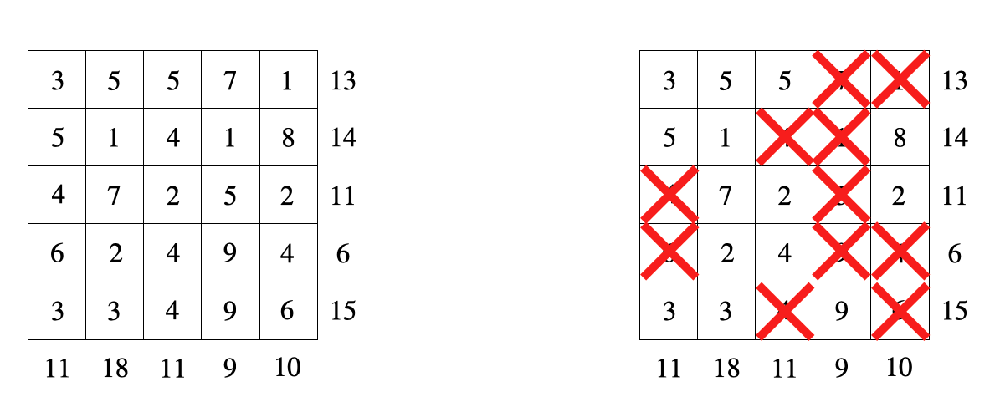
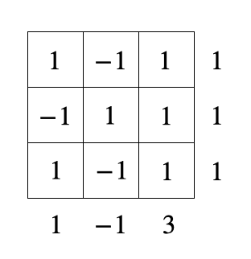
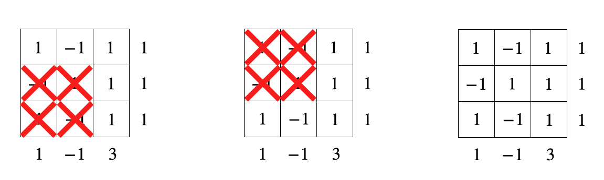

## 题目描述

时间限制：3.0 秒；内存限制：1024 MB。

Sumplete 是一种类似于数独、Kakuro 和 Hitori 的逻辑谜题。它因在 ChatGPT 的帮助下开发而闻名。

Sumplete 谜题由一个方格网组成，每个单元格中包含一个整数。每一行和每一列也都有一个分配的整数“提示”。玩家必须划掉网格中的一些数字，使得每一行和每一列中未被划掉的数字之和等于相应的提示。请参阅下图以获取说明。



一个 5 × 5 Sumplete 谜题示例（左）及其解法（右）

最近，在 2023 年 9 月 15 日，Suthee Ruangwises 在 arXiv 上上传了一篇题为《Sumplete is Hard, Even with Two Different Numbers》的论文。该论文表明，如果我们允许 Sumplete 谜题的网格为矩形，那么判定给定的 Sumplete 谜题是否有解是 NP 完全问题，即使网格仅包含 1 和 3 这两个不同的数字。

Bobo 对这个结果很不满意。他坚持认为一定存在一些容易求解的 Sumplete 谜题。现在他为你提供了一个 Sumplete 谜题，其中网格仅包含 -1 和 1 这两个不同的数字。你能帮他解开这个谜题吗？

## 输入格式

输入的第一行包含一个整数 $n$ ($1 \le n \le 4000$)，表示 Sumplete 谜题网格的高度和宽度。

接下来 $n$ 行，其中第 $i$ 行 ($1 \le i \le n$) 包含一个长度为 $n$ 的字符串 $s_i$，由 '+' 和 '-' 组成，使得如果 $s_i$ 的第 $j$ 个字符是 '+'，则 $a_{i,j} = 1$；如果 $s_i$ 的第 $j$ 个字符是 '-'，则 $a_{i,j} = -1$。

输入接着包含一行，包含 $n$ 个整数 $r_1, r_2, \dots, r_n$ ($-n \le r_i \le n$)，其中第 $i$ 个数字表示第 $i$ 行的提示。

最后，输入包含一行，包含 $n$ 个整数 $c_1, c_2, \dots, c_n$ ($-n \le c_i \le n$)，其中第 $i$ 个数字表示第 $i$ 列的提示。

## 输出格式

如果给定的 Sumplete 谜题无解，请在第一行输出“No”。否则，在第一行输出“Yes”。你可以以任何大小写形式输出每个字母。例如，字符串“yEs”、“yes”、“Yes”和“YES”都将被视为肯定回答。

如果你的回答是“Yes”，请在接下来的 $n$ 行中每行输出一个长度为 $n$ 的二进制字符串。在第 $i$ 行 ($1 \le i \le n$) 中，你需要输出一个长度为 $n$ 的字符串 $t_i$，由 '0' 和 '1' 组成，其中 $t_i$ 的第 $j$ 个字符为 '0' 表示你划掉了第 $i$ 行第 $j$ 列的数字，第 $j$ 个字符为 '1' 表示你保留了该数字。你的解法必须满足每一行和每一列中未被划掉的数字之和等于相应的提示。如果存在多个解，输出其中任何一个均被视为正确。

## 样例

### 样例输入 1

```text
3
+-+
-++
+-+
1 1 1
1 -1 3
```

### 样例输出 1

```text
Yes
111
001
001
```

### 样例输入 2

```text
3
---
-++
+++
-2 -1 0
-2 -1 0
```

### 样例输出 2

```text
Yes
110
100
000
```

### 样例输入 3

```text
3
+-+
-++
++-
1 0 2
2 2 -1
```

### 样例输出 3

```text
No
```

## 说明

第一个样例对应于以下 3 × 3 Sumplete 谜题：



其三个解法列出如下（第三个对应于不划掉网格中的任何数字），输出其中任何一个均被视为正确。


