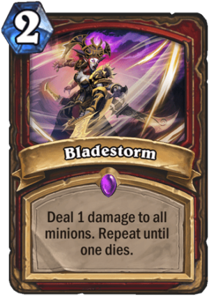

## 题目描述

时间限制：4 秒；内存限制：1024 MB。

在《炉石传说》中，“剑刃乱舞”（Bladestorm）是一张强力的战士职业法术牌，如下图所示。其效果是对所有随从造成 1 点伤害，直到有随从死亡。



在实际对局中，剑刃乱舞本身无法处理复杂的场面，因此通常会与其他群体伤害法术配合使用。现在 Bobo 正在玩战士职业，他的对手依次打出了生命值为两两不同（pairwise distinct）的随从 $a_1, a_2, \dots, a_n$（$1 \le a_i \le n$）。Bobo 有无限多的剑刃乱舞和可以对所有随从造成 $k$ 点伤害的法术，并且假设他可以以任意顺序使用这些法术。他想知道，每当对手打出一个随从后，他最少需要使用多少个法术才能清除场上所有的随从？

形式化地，对于每个 $i = 1, 2, \dots, n$，令 $S_i = \{a_1, a_2, \dots, a_i\}$ 为包含前 $i$ 个随从生命值的集合。Bobo 想要计算 $ans_i$，即通过以下操作使 $S_i$ 为空所需的最少操作次数：

-   使用剑刃乱舞：
    1.  对于每个 $x \in S_i$，令 $x \leftarrow x - 1$。
    2.  如果 $S_i$ 中至少包含一个 0，则从 $S_i$ 中删除所有 0 并结束此操作。否则，跳转至第 1 步。
-   使用普通群体伤害法术：对于每个 $x \in S_i$，令 $x \leftarrow x - k$，并从 $S_i$ 中删除所有不大于 0 的元素。

## 输入格式

本题包含多个测试点。第一行包含一个整数 $T$ ($1 \le T \le 50\,000$)，表示测试用例的数量。

对于每个测试用例，第一行包含两个整数 $n, k$ ($1 \le k \le n \le 10^5$)，分别表示对手打出的随从数量和普通群体伤害法术造成的伤害。

接下来一行包含 $n$ 个两两不同的整数 $a_1, a_2, \dots, a_n$ ($1 \le a_i \le n$)，表示对手依次打出的每个随从的生命值。

保证所有测试用例中 $n$ 的总和不超过 $5 \cdot 10^5$。

## 输出格式

对于每个测试用例，在一行中输出 $n$ 个整数 $ans_1, ans_2, \dots, ans_n$，其中第 $i$ 个 ($1 \le i \le n$) 整数表示在对手打出前 $i$ 个随从后，Bobo 清除场上所有随从所需的最少法术数量。

## 样例

### 输入 1

```text
3
7 2
4 7 3 6 1 2 5
11 3
10 7 4 9 6 8 5 1 3 2 11
9 2
1 2 3 7 8 9 4 5 6
```

### 输出 1

```text
1 2 3 3 4 4 4
1 2 3 3 3 3 3 4 4 4 4
1 1 2 3 4 4 4 5 5
```
