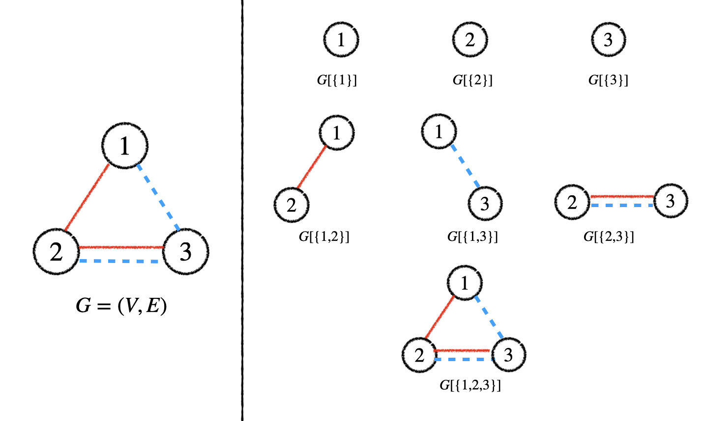

## 题目描述

时间限制：1.0 秒；内存限制：1024 MB。

Bobo 最近得到了一个（无向）图 $G = (V, E)$。他注意到该图的每条边都被染成了红色或蓝色，且该图的最大度数不超过 3。

现在，Bobo 想知道有多少个非空的导出子图 $G[S] = (S, E')$ 满足以下两个条件：

-   仅保留 $G[S]$ 中的红色边所形成的图是连通的。
-   仅保留 $G[S]$ 中的蓝色边所形成的图也是连通的。

由于答案可能很大，你需要输出结果对 $998\,244\,353$（一个质数）取模后的值。

请参考说明部分以获取下划线术语的正式定义及更多图示。

## 输入格式

第一行包含两个整数 $n$ ($1 \le n \le 10^5$) 和 $m$ ($0 \le m \le 1.5 \times 10^5$)，分别表示图 $G$ 的顶点数和边数。

接下来 $m$ 行，每行包含三个整数 $u, v, c$ ($1 \le u, v \le n, u \neq v, c \in \{0, 1\}$)，表示存在一条边 $(u, v)$，若 $c = 0$ 则颜色为红色，否则为蓝色。

保证 $G$ 的最大度数不超过 3，且没有两条颜色相同的边连接同一对顶点。请注意，图中可能存在连接同一对顶点但颜色不同的多条边。

## 输出格式

输出一行一个整数，表示满足条件的导出子图数量，对 $998\,244\,353$ 取模。

## 样例

### 样例输入 1

```text
3 4
1 2 0
1 3 1
2 3 0
2 3 1
```

### 样例输出 1

```text
5
```

### 样例输入 2

```text
4 6
1 2 0
2 3 0
3 4 0
1 4 1
2 4 1
1 3 1
```

### 样例输出 2

```text
5
```

## 说明

此处提供题目中部分下划线术语的正式定义：

-   图的顶点的度数是指与该顶点关联的边的数量。
-   图 $G$ 的最大度数是指其所有顶点度数中的最大值。
-   图 $G = (V, E)$ 的导出子图是另一个图 $G[S] = (S, E')$，由顶点集的一个子集 $S$ 以及原图 $G$ 中连接 $S$ 内顶点对的所有边 $E'$ 构成。当且仅当 $S \neq \emptyset$ 时，导出子图 $G[S]$ 是非空的。
-   如果图中的每一对顶点都是连通的，即每一对顶点之间都存在路径，则称该图是连通的。

下图列出了第一个样例测试中图 $G = (V, E)$ 及其所有七个非空导出子图。其中，实线表示红色边，虚线表示蓝色边。共有五个非空导出子图满足要求，分别是 $G[\{1\}]$、$G[\{2\}]$、$G[\{3\}]$、$G[\{2, 3\}]$ 和 $G[\{1, 2, 3\}]$。



图 $G = (V, E)$ 及其所有七个非空导出子图
