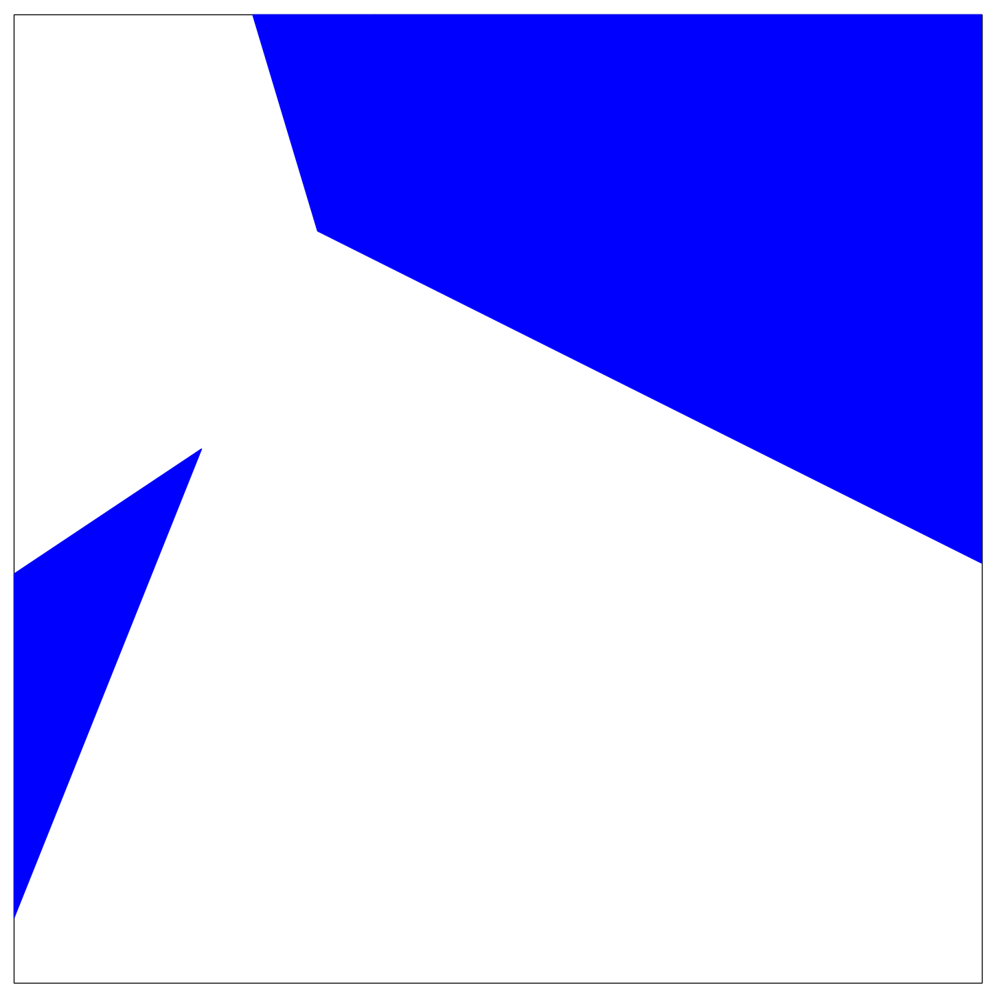

## 题目描述

时间限制：3.0 秒；内存限制：1024 MB。

最近，Bobo 想要从地主那里购买一块土地。然而，Bobo 并不想买下整块矩形土地，他只想购买满足特定要求的那部分土地。

从数学角度来看，这块矩形土地定义为笛卡尔坐标系下的点集： 

$$
L = \{(x, y) : x_{\min} \le x \le x_{\max}, y_{\min} \le y \le y_{\max}\}
$$

Bobo 的要求被编码为一个逻辑公式。该逻辑公式的语法描述如下：

`<formula> := "(" <formula> "&" <formula> ")"`  
`| "(" <formula> "|" <formula> ")"`  
`| "(" <formula> "^" <formula> ")"`  
`| "(" "!" <formula> ")"`  
`| <atomic-formula>`  
`<atomic-formula> := "[" <decimal> "," <decimal> "," <decimal> "]"`

其中 "&"、"|" 和 "^" 分别表示与（And）、或（Inclusive Or）和异或（Exclusive Or）运算符；`<decimal>` 指任何带符号的十进制整数；原子公式 $[a, b, c]$ 表示约束 $ax + by + c \ge 0$。形式上，他想要购买的土地部分是 $L$ 中满足给定逻辑公式的点集。

为了进行交易，他们想知道 Bobo 想要购买的那部分土地的面积。你能告诉他们答案吗？

## 输入格式

第一行包含四个整数 $x_{\min}, x_{\max}, y_{\min}, y_{\max}$ ($x_{\min} < x_{\max}, y_{\min} < y_{\max}$)，其绝对值不超过 $1\,000$，指定了矩形土地的区域。

第二行是逻辑公式。该公式包含不超过 $10\,000$ 个字符，且最多包含 $300$ 个原子公式。逻辑公式严格符合题目描述的语法；标记之间没有空格，也没有省略括号。对于每个原子公式 $[a, b, c]$，保证 $|a|, |b|, |c| \le 1\,000$ 且 $a^2 + b^2 \neq 0$。

## 输出格式

输出一行一个数字，表示地主想要出售的那部分土地的面积。如果答案的绝对误差或相对误差不超过 $10^{-6}$，则视为正确。

## 样例

### 输入 1

```text
0 1 0 1
([-1,1,0]^[-1,-1,1])
```

### 输出 1

```text
0.5
```

### 输入 2

```text
-5 10 -10 5
((!([1,2,-3]&[10,3,-2]))^([-2,3,1]|[5,-2,7]))
```

### 输出 2

```text
70.451693404634582
```

### 输入 3

```text
0 1 -1 1
([1,1,1]&[-1,-1,-1])
```

### 输出 3

```text
0
```

## 说明

注意，在第二个样例测试中，存在一个表示换行的 “\\”，这在实际输入中是不存在的。此处添加换行仅为了更好的格式化和说明。

前两个样例测试数据的绘图如下所示，其中填充部分代表 Bobo 想要购买的土地部分。



