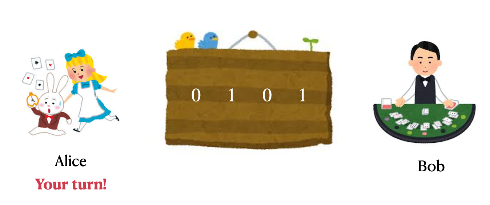
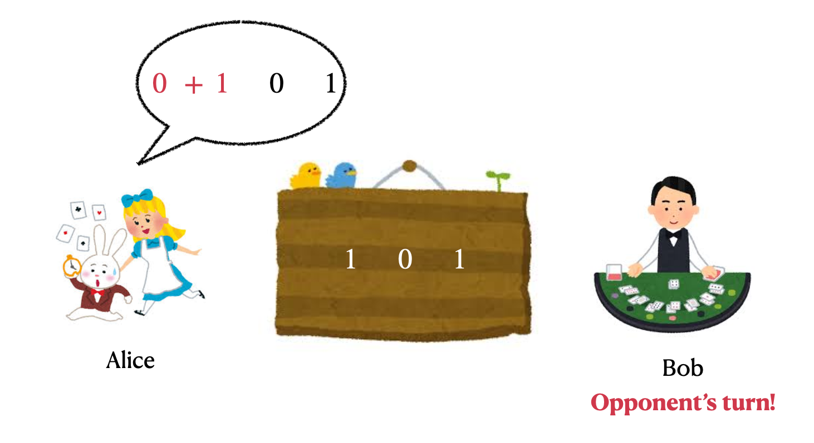
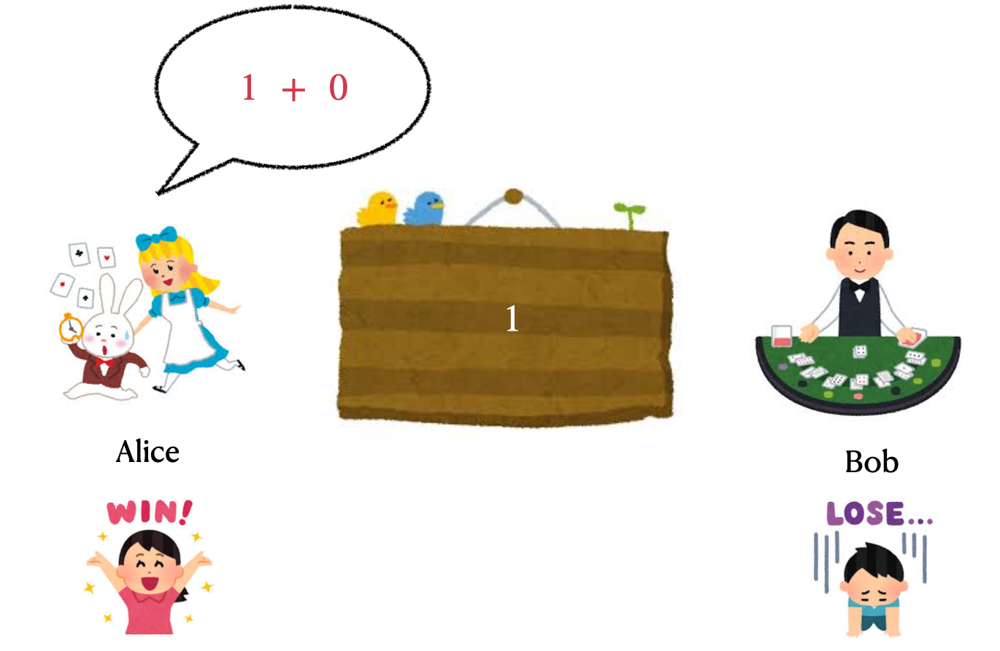

## 题目描述

时间限制：1.0 秒；内存限制：1024 MB。

这是一个交互式问题。

Alice 和 Bob 正在进行如下游戏。游戏由参数 $t \in \{0, 1\}$ 指定，规则如下：

有 $n$ 个整数 $a_1, a_2, \dots, a_n \in \{0, 1\}$ 排成一行。只要还剩至少两个整数，两名玩家就轮流进行以下操作（从 Alice 开始）：

-   选择两个相邻的整数 $x$ 和 $y$，将它们替换为 $x + y$ 或 $x \times y$（算术加法或算术乘法）。

当只剩下一个整数时游戏结束，根据剩余整数的奇偶性与参数 $t$ 判断胜负：

-   $t = 0$：若剩余整数为偶数，则 Alice 获胜；否则 Bob 获胜。
-   $t = 1$：若剩余整数为奇数，则 Alice 获胜；否则 Bob 获胜。

给定初始的 $n$ 个整数 $a_1, a_2, \dots, a_n$ 和参数 $t$。你必须选择扮演 Alice 或 Bob，然后与扮演对手角色的交互器进行游戏。你的目标是赢得游戏。

## 输入格式

第一行包含两个整数 $n$ 和 $t$ ($2 \le n \le 500, t \in \{0, 1\}$)，分别表示数组的大小和游戏参数。

第二行包含 $n$ 个整数 $a_1, a_2, \dots, a_n$ ($0 \le a_i \le 1$)，表示数组。

## 交互

交互在读取两个整数 $n, t$ 和数组 $\{a_i\}_{1 \le i \le n}$ 后开始。

你应当首先输出一行，内容为 “Alice” 或 “Bob”，表示你选择扮演的角色。如果你选择扮演 Alice，你将先手操作。否则，你将后手操作。

游戏过程如下：

-   如果是你的回合：假设当前数组为 $b_1, b_2, \dots, b_m$，长度为 $m$ ($2 \le m \le n$)，你应当输出一个整数 $p$ ($1 \le p \le m-1$) 和一个字符 $c$ ($c \in \{\texttt{+}, \texttt{*}\}$)，中间用空格隔开，表示你选择使用运算符 $c$ 合并两个整数 $b_p$ 和 $b_{p+1}$。操作后，数组变为 $b_1, b_2, \dots, b_{p-1}, (b_p \ c \ b_{p+1}), b_{p+2}, \dots, b_m$，长度变为 $m-1$。
-   如果是对手的回合：假设当前数组为 $b_1, b_2, \dots, b_m$，长度为 $m$ ($2 \le m \le n$)，你应当读取一行，包含一个整数 $p$ ($0 \le p \le m-1$) 和一个字符 $c$ ($c \in \{\texttt{+}, \texttt{*}\}$)，表示对手选择使用运算符 $c$ 合并两个整数 $b_p$ 和 $b_{p+1}$。操作后，数组变为 $b_1, b_2, \dots, b_{p-1}, (b_p \ c \ b_{p+1}), b_{p+2}, \dots, b_m$，长度变为 $m-1$。如果读取到的整数 $p$ 为 $0$，则意味着你上一次的操作不合法。在这种情况下，你的程序应立即终止以接收 “Wrong Answer” 判决，否则你可能会收到任何可能的判决。

当数组中只剩下一个整数时，游戏结束，并根据题目规则进行判定。如果你赢得了游戏，你的程序将被判定为正确。如果你输掉了游戏，或者轮到你进行最后一次操作时你的操作无效，你将收到 “Wrong Answer” 判决。游戏结束时，你应该立即终止程序。

在输出你选择的角色以及你的操作后，请务必输出换行并刷新缓冲区。否则，你可能无法获得正确的判决。刷新缓冲区的方法如下：

-   C++: `fflush(stdout)` 或 `cout.flush()`；
-   Java: `System.out.flush()`；
-   Python: `stdout.flush()`。

## 样例

### 输入 1

```text
4 1
0 1 0 1
```

### 输出 1

```text
Alice
1 +
1 +
```

## 说明

注意，样例中的额外空行仅为了方便理解，你在程序中不应输出任何额外的空行。

此处提供样例交互的图形说明。对于给定的 $\{a_i\}_{1 \le i \le n}$ 和 $t$，选择扮演 Alice 并先手是该玩家的最优策略。

在样例交互中，玩家选择使用加法运算符合并前两个数字：



Alice 的回合！

对手选择使用乘法运算符合并最后两个数字：



Bob 的回合！

然后，玩家选择使用加法运算符合并剩余的两个数字并赢得游戏：



Alice 获胜！ Bob 失败...
