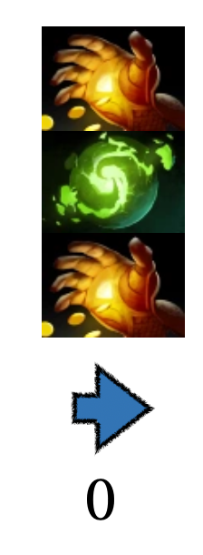
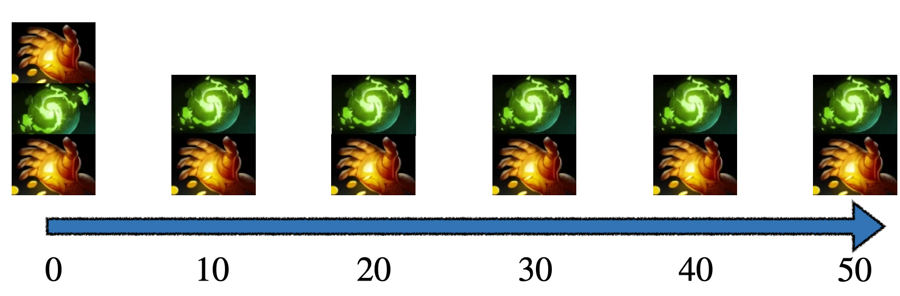
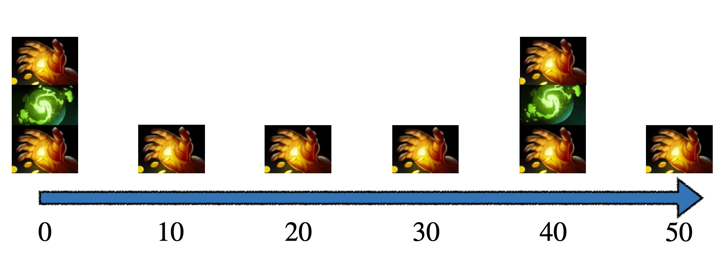

## 题目描述

时间限制：1.0 秒；内存限制：1024 MB。

“点金手”（Hand of Midas）是 Dota2 中的一件物品，使用后可以击杀一个非英雄单位并获得大量金钱。使用点金手可以获得 160 金币。点金手的冷却时间为 $a$ 秒，这意味着它在上次使用后需要等待 $a$ 秒才能再次使用。

“刷新球”（Refresher Orb）是 Dota2 中的另一件强力物品。使用后，它会刷新使用者所有其他技能和物品的冷却时间，使使用者能够立即再次施放技能或使用物品。例如，如果你的点金手处于冷却中，而刷新球没有，你可以使用刷新球，从而立即再次使用点金手。刷新球的冷却时间为 $b$ 秒。显然，使用刷新球不会刷新刷新球自身的冷却时间。

你在游戏中同时购买了点金手和刷新球，现在你想在接下来的 $m$ 秒内获得尽可能多的金钱！目前，你的点金手和刷新球均处于冷却结束状态。我们假设使用点金手和刷新球所花费的时间可以忽略不计。

## 输入格式

本题包含多个测试点。第一行包含一个整数 $T$ ($1 \le T \le 10\,000$)，表示测试用例的数量。

对于每个测试用例，输入一行包含三个整数 $a, b, m$ ($1 \le a, b \le 10^6, 0 \le m \le 10^6$)，分别表示点金手的冷却时间、刷新球的冷却时间以及你拥有的最大时间。

保证所有测试用例中 $a, b$ 和 $m$ 的总和分别不超过 $10^7$。

## 输出格式

对于每个测试用例，输出一行一个整数，表示你能获得的最大金币数量。

## 样例

### 输入 1

```text
6
50 100 0
40 10 50
10 40 50
1 1 1000000
60 200 960
60 185 905
```

### 输出 1

```text
320
1120
1280
320000320
3520
3360
```

## 说明

对于样例中的第一个测试用例，最优策略是使用点金手，然后立即使用刷新球，接着再次使用点金手，总共获得 $160 \times 2 = 320$ 金币。该策略在下图中描述（球状物品为刷新球，手状物品为点金手）。



对于样例中的第二个测试用例，最优策略如下图所示，总共获得 $160 \times 7 = 1120$ 金币。



对于样例中的第三个测试用例，最优策略如下图所示，总共获得 $160 \times 8 = 1280$ 金币。


