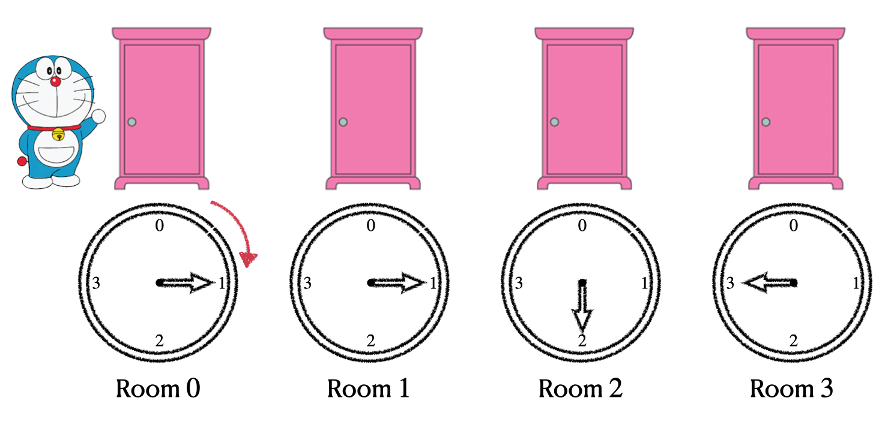
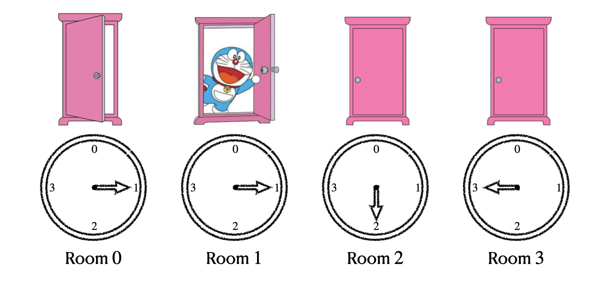
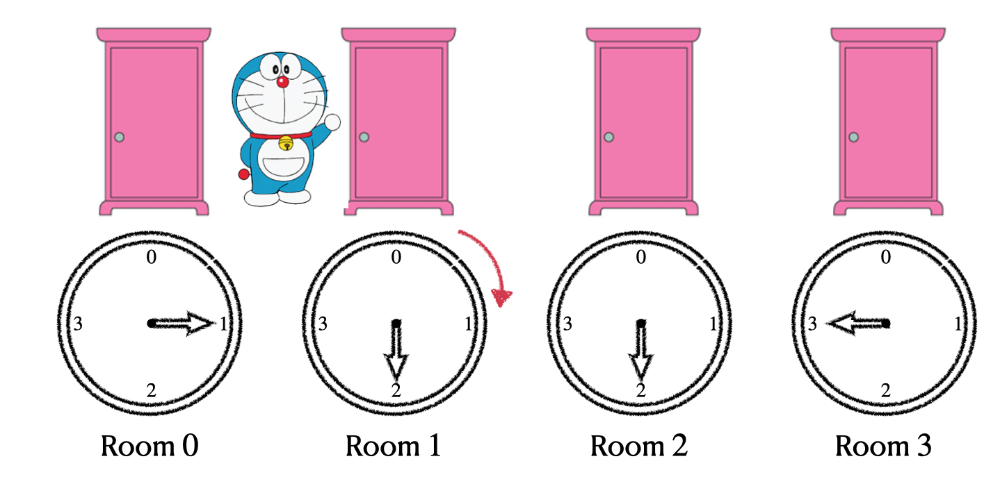
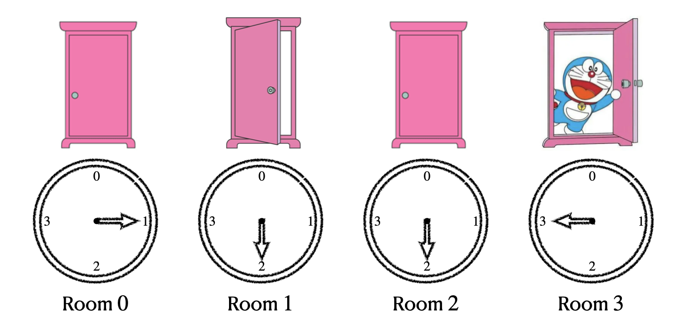

## 题目描述

时间限制：1.0 秒；内存限制：1024 MB。

Bobo 最近参观了一个奇怪的传送系统。该系统包含 $n$ 个房间，编号为 $0$ 到 $n-1$。每个房间都安装了一个传送装置。每个传送装置都包含一个看起来像时钟表盘的仪表板，上面有一个指针，按顺时针方向显示 $0$ 到 $n-1$ 的数字。最初，第 $i$ 个房间（$0 \le i \le n-1$）中传送装置仪表板上的指针指向数字 $a_i$。

当 Bobo 在房间 $i$（$0 \le i \le n-1$）时，他可以进行任意次数的以下操作：

-   传送：立即传送到房间 $(i + a_i) \pmod n$。
-   顺时针移动指针：设置 $a_i \leftarrow a_i + 1$。

每次操作需要一个单位时间。Bobo 从房间 $0$ 开始，他想尽快到达某个房间 $x$。他想知道需要多长时间。

## 输入格式

第一行包含两个整数 $n$（$2 \le n \le 10^5$）和 $x$（$1 \le x \le n-1$），分别表示房间总数和 Bobo 的目标房间。

下一行包含 $n$ 个整数 $a_0, a_1, \dots, a_{n-1}$（$0 \le a_i \le n-1$），其中 $a_i$（$0 \le i \le n-1$）表示第 $i$ 个房间中仪表板指针指向的数字。

## 输出格式

输出一行一个整数，表示 Bobo 从房间 $0$ 到达房间 $x$ 所需的最短时间。

## 样例

### 输入格式 1

```text
4 3
0 1 2 3
```

### 输出格式 1

```text
4
```

### 输入格式 2

```text
4 3
0 0 0 0
```

### 输出格式 2

```text
4
```

### 输入格式 3

```text
4 3
2 2 2 2
```

### 输出格式 3

```text
2
```

## 说明

这里我们提供了第一个样例中一种可能的最佳路径的图形说明。最初，Bobo 在房间 $0$，每个仪表板上的指针分别指向 $0, 1, 2, 3$。



Bobo 进行的第一个操作是顺时针移动指针，使得房间 $0$ 的仪表板指针指向 $1$。($a_0 = 1$)



然后 Bobo 传送到房间 $(0 + a_0) \pmod n = 1$。



之后，Bobo 顺时针移动指针，使得房间 $1$ 的仪表板指针指向 $2$。($a_1 = 2$)



然后 Bobo 传送到房间 $(1 + a_1) \pmod n = 3$，到达了他的目标目的地。总共花费了 $4$ 次操作。
