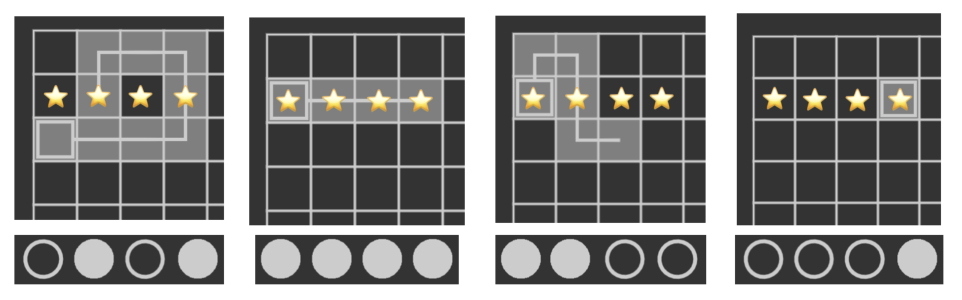

## 题目描述

时间限制：2.0 秒；内存限制：1024 MB。

这是一个交互式问题。

在简化版的“Understand”游戏中，你处于一个 $256 \times 256$ 的网格中。网格内有 $n$ 个物品，其具体位置尚不明确。多个物品可能位于同一个网格单元中。

你的任务是通过一系列交互式查询来确定每个物品的位置，查询次数限制为不超过 16 次。每次查询允许你在网格上绘制一条简单路径，交互器将返回一个长度为 $n$ 的二进制字符串，表示每个物品是否在该路径上。

保证交互器是非自适应的，这意味着物品的位置在开始查询之前就已经确定了。

## 输入格式

输入的第一行包含一个整数 $n$ ($1 \le n \le 10\,000$)，表示网格中物品的数量。

## 交互

交互在读取整数 $n$ 后开始。

然后，进行最多 16 次查询。进行查询的方式为：在一行中输出 “? $x_0$ $y_0$ $k$ $s$”。其中，$1 \le x_0, y_0 \le 256$ 表示路径从上到下的第 $x_0$ 行、从左到右的第 $y_0$ 列开始。$1 \le k \le 256 \times 256$ 表示简单路径的长度。$s$ 是一个长度为 $k-1$ 的字符串，由字符 ‘L’、‘R’、‘U’ 和 ‘D’ 组成。第 $i$ 个字符表示从路径上第 $i$ 个单元格移动到第 $i+1$ 个单元格的方向，其中：

-   ‘L’ 表示从 $(x, y)$ 移动到 $(x, y-1)$，
-   ‘R’ 表示从 $(x, y)$ 移动到 $(x, y+1)$，
-   ‘U’ 表示从 $(x, y)$ 移动到 $(x-1, y)$，
-   ‘D’ 表示从 $(x, y)$ 移动到 $(x+1, y)$。

如果 $k=1$，你可以直接输出 “? $x_0$ $y_0$ $k$”，也可以不输出额外的空格（这样做也是允许的）。

此处，你输出的路径必须是简单的，这意味着你的路径不应经过同一个网格单元超过一次。此外，路径必须位于 $256 \times 256$ 的网格内，这意味着路径上的每个网格 $(x, y)$ 都必须满足 $1 \le x, y \le 256$。

在你以正确格式输出查询后，读取一个长度为 $n$ 的二进制字符串 $t$，其中如果第 $i$ 个物品 ($1 \le i \le n$) 在你的路径上，则 $t$ 的第 $i$ 个字符为 1，否则为 0。如果你的查询无效或查询次数超过 16 次，你将收到单个字符 ‘-’。读取该字符后，你的程序必须立即终止以接收 “Wrong Answer” 判决，否则你可能会得到任何可能的判决。

在交互的任何时刻，如果你想猜测每个物品的位置，请在一行中输出 “! $x_1$ $y_1$ $x_2$ $y_2 \dots x_n$ $y_n$”，其中 $(x_i, y_i)$ 表示你猜测的第 $i$ 个物品的位置。此猜测不计入查询次数。执行此操作后，你应该立即终止你的程序。

在打印每次查询和答案后，不要忘记输出换行符并刷新输出。否则，你可能无法获得正确的判决。要刷新输出，请使用：

-   C++ 中的 `fflush(stdout)` 或 `cout.flush()`；
-   Java 中的 `System.out.flush()`；
-   Python 中的 `stdout.flush()`。

## 样例

### 输入格式 1

```text
4
0101
1111
1100
0001
```

### 输出格式 1

```text
? 3 1 9 RRRUULLD
? 2 1 4 RRR
? 2 1 6 URDDR
? 2 4 1
! 2 1 2 2 2 3 2 4
```

### 说明

请注意，样例测试中的额外空行仅为了方便理解，你不应在程序中输出任何额外的空行。

在此，我们提供样例测试中交互的图形说明。在下图中，我们仅展示了棋盘左上角的 $4 \times 4$ 部分，但棋盘的实际大小为 $256 \times 256$。所有四个物品的位置都用星号标记。每个查询路径的起点用正方形标记，结果显示在路径下方（实心圆代表 1，空心圆代表 0）。


