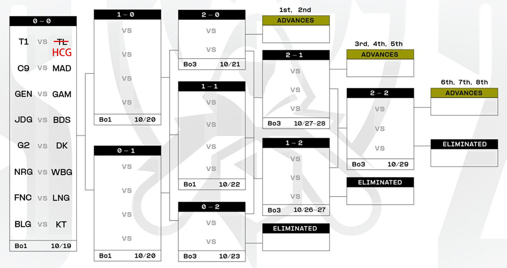

## 题目描述

时间限制：1.0 秒；内存限制：512 MB。

时隔五年，《英雄联盟》全球总决赛（Worlds）重返韩国。这项英雄联盟电竞赛事的巅峰盛会定于 10 月至 11 月在“晨静之地”举行。

2023 年全球总决赛带来了令人兴奋的新赛制，包括瑞士轮阶段，以及为队伍提供的全新晋级路径。



2023 年全球总决赛瑞士轮阶段（图片来源：Riot Games）

在 2023 年全球总决赛的瑞士轮阶段中，16 支参赛队伍总共进行 5 轮比赛。在每一轮中，队伍将根据其胜负记录进行配对，胜负场数相同的队伍将相互对阵。涉及晋级和淘汰的轮次（即队伍累计两胜或两负时的轮次）将采用三局两胜制（Bo3），即率先在三局比赛中赢得两局的队伍赢得该轮比赛，另一方告负（如果一支队伍在前两局比赛中连续击败对手，则无需进行第三局）。其他轮次将采用单局淘汰制（Bo1），即在唯一的一局比赛中击败对手的队伍赢得该轮比赛，另一方告负。累计三胜的队伍晋级下一阶段，而累计三负的队伍则告别本次锦标赛。

现在 HCG 战队有 $x$ 胜 $y$ 负，作为 HCG 战队的教练，你想知道 HCG 战队为了晋级下一阶段，最少还需要进行多少场比赛。

## 输入格式

输入仅一行，包含两个整数 $x$ 和 $y$ ($0 \le x, y \le 2$)，表示 HCG 战队当前的胜负场数。

## 输出格式

输出一个整数，表示 HCG 战队为了晋级下一阶段，最少还需要进行的额外比赛场数。

## 样例

### 样例输入 1

```text
0 1
```

### 样例输出 1

```text
4
```

### 样例输入 2

```text
1 2
```

### 样例输出 2

```text
4
```

## 说明

在第一个样例中，HCG 战队可以通过赢得两轮单局淘汰制比赛和一轮三局两胜制比赛来晋级，最少需要进行 4 场额外比赛。

在第二个样例中，HCG 战队必须连续赢得两轮三局两胜制比赛才能晋级，最少需要进行 4 场额外比赛。
