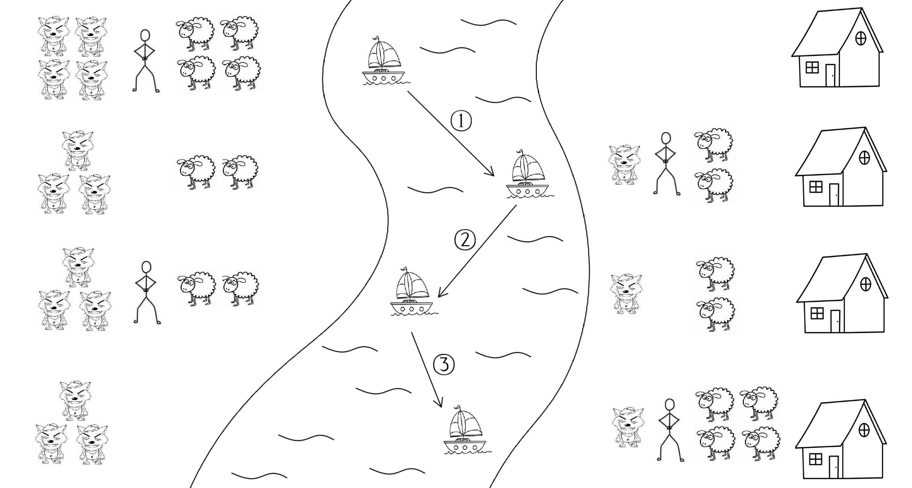

## 题目描述

时间限制：2.0 秒；内存限制：512 MB。

Farmer John 有 $x$ 只羊，有一天，$y$ 只狼来到了他放羊的河边。

为了安全起见，Farmer John 想要立即将所有 $x$ 只羊运送到河对岸的家中。河岸边有一条船，Farmer John 每次最多可以带 $p$ 只动物过河。Farmer John 只能使用这艘船在两岸之间往返运送动物。

然而，如果有一群动物不在 Farmer John 的监管之下，且这群动物中既有狼又有羊，并且狼的数量严格大于羊的数量加 $q$，那么狼就会吃掉羊。当且仅当动物在船上或与 Farmer John 在同一河岸时，它们才处于 Farmer John 的监管之下。

现在 Farmer John 想知道将所有羊安全运送到河对岸家中所需的最少往返次数，如果无法完成，则确定其为不可能。

## 输入格式

输入仅一行，包含四个整数 $x$ ($1 \le x \le 100$)，表示羊的数量；$y$ ($1 \le y \le 100$)，表示狼的数量；$p$ ($1 \le p \le 100$)，表示 Farmer John 每次运送时最多能带的动物数量；以及 $q$ ($0 \le q \le 100$)，表示狼吃羊的阈值，即当不在 Farmer John 监管下的一群动物中，狼的数量严格大于羊的数量加 $q$ 时，狼会吃掉羊。

## 输出格式

输出一行，包含一个整数，表示将所有 $x$ 只羊安全运送到 Farmer John 河对岸家中所需的最少往返次数。如果无法安全地将所有羊运回家，则输出 $-1$。

## 样例

### 输入 1

```text
4 4 3 1
```

### 输出 1

```text
3
```

### 输入 2

```text
3 5 2 0
```

### 输出 2

```text
5
```

### 输入 3

```text
2 5 1 1
```

### 输出 3

```text
-1
```

## 说明



图：第一个样例的一种可能解法
