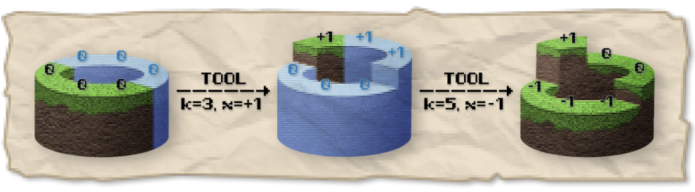

## 题目描述

时间限制：3 秒；内存限制：512 MB。


耳廓狐 Sulfox 开心地度过了自己的 20 岁生日，因为他收到了一份特别的礼物：一款名为 World Rebuilder 的像素游戏。在游戏中，他扮演一名星际探险家，向小熊座最亮的恒星——北极星进发，并改造沿途的星球。

一个关卡由目标序列 $a_1,a_2,\ldots,a_n$ 和工具序列 $b_1,b_2,\ldots,b_m$ 决定。关卡开始时，Sulfox 降落的星球上有 $n$ 块大陆，沿赤道环形排列，初始高度均为 $0$。

“批量编辑”工具可以同时修改若干块大陆的高度。每次使用时，Sulfox 先从工具序列中选择一个数 $k$，再选择任意实数 $x$，然后恰好选取连续的 $k$ 块大陆，将它们的高度都增加 $x$。当从某块大陆出发，沿某个方向依次看到的 $n$ 块大陆的高度为 $a_1,a_2,\ldots,a_n$ 时，就算通过了这个关卡。



上图展示了“批量编辑”工具的使用过程，选中的大陆以高亮标出。

实际上，这款游戏的关卡设计师非常懒。他只会从全局目标序列 $A_1,A_2,\ldots,A_N$ 和全局工具序列 $B_1,B_2,\ldots,B_M$ 中各选取一个连续子序列，以此生成关卡。更糟糕的是，他甚至懒得检查这些关卡能否通关，害得 Sulfox 卡在了某些标着“简单”的关卡上！

好在这是一款电子游戏，总会发布多个版本来修复漏洞（也可能引入新的漏洞，谁知道呢？）。现在给定初始版本中的全局目标序列和全局工具序列，你需要处理以下两类事件，共 $Q$ 次：

- 游戏更新：在新版本中，将 $A_p$ 的值改为 $v$。
- 关卡询问：在最新版本中，以 $A_l,A_{l+1},\ldots,A_r$ 为目标序列、$B_s,B_{s+1},\ldots,B_t$ 为工具序列，判断 Sulfox 能否在使用工具任意次后通过这个关卡。

## 输入格式

第一行包含三个整数 $N,M,Q$（$1\le N,M,Q\le2\times10^5$），分别表示全局目标序列的长度、全局工具序列的长度和事件数量。

第二行包含 $N$ 个整数 $A_1,A_2,\ldots,A_N$（$0\le A_i\le10^9$），表示初始版本的全局目标序列。

第三行包含 $M$ 个整数 $B_1,B_2,\ldots,B_M$（$1\le B_i\le N$），表示全局工具序列。

接下来 $Q$ 行，每行按以下两种格式之一给出一个事件：

- `U p v`（$1\le p\le N$，$0\le v\le10^9$）：在新版本中，将 $A_p$ 的值改为 $v$。
- `Q l r s t`（$1\le l\le r\le N$，$1\le s\le t\le M$）：在最新版本中，询问 Sulfox 能否通过目标序列为 $A_l,A_{l+1},\ldots,A_r$、工具序列为 $B_s,B_{s+1},\ldots,B_t$ 的关卡。保证 $B_s,B_{s+1},\ldots,B_t$ 中每个数都不超过 $r-l+1$。

## 输出格式

对于每次询问，如果 Sulfox 能在最新版本中通过给定目标序列和工具序列确定的关卡，输出一行 `Yes`；否则输出一行 `No`。

## 样例

### 输入

```text
6 4 5
1 1 4 5 1 4
3 3 2 4
Q 1 5 1 2
Q 2 5 3 4
U 5 2
Q 1 6 1 2
Q 2 5 3 4
```

### 输出

```text
Yes
No
No
Yes
```
