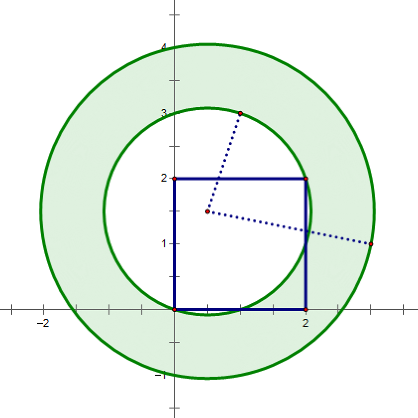

## 题目描述

时间限制：6.0 秒；内存限制：512 MB。

一场军事演习正在二维笛卡尔平面上进行，$n$ 个敌方目标隐藏在战场上的某处，其位置为我方指挥部所知。

我方指挥部将在一个边平行于坐标轴的矩形区域内随机均匀空投一个信标，以向我方部队暴露所有敌方目标，从而使我方部队能够包围所有敌方目标。该区域的左下角坐标为 $(x_l, y_l)$，右上角坐标为 $(x_r, y_r)$。

信标被投放后，首先会从指挥部接收两个满足 $0 \le r \le R$ 的参数 $r$ 和 $R$，然后扫描一个圆环区域（即两个同心圆之间的区域，其中内圆半径为 $r$，外圆半径为 $R$），最后标记出隐藏在扫描区域内的敌方目标（包括边界）。

然而，信标在单位时间内只能扫描单位面积，指挥官想知道信标扫描指定圆环区域以标记所有敌方目标的期望最小时间。

## 输入格式

第一行包含四个整数 $x_l, y_l, x_r$ 和 $y_r$ ($-10\,000 \le x_l, y_l, x_r, y_r \le 10\,000, x_l < x_r, y_l < y_r$)，表示投放信标的矩形区域的左下角和右上角坐标。

第二行包含一个整数 $n$ ($2 \le n \le 2\,000$)，表示战场上敌方目标的数量。

接下来的 $n$ 行，每行包含两个整数 $x$ 和 $y$ ($-10\,000 \le x, y \le 10\,000$)，表示一个位于坐标 $(x, y)$ 的敌方目标。

保证没有两个敌方目标位于相同的位置。

## 输出格式

输出一个实数，表示信标扫描指定圆环区域的期望最小时间。

如果你的输出与标准答案的绝对误差或相对误差不超过 $10^{-6}$，则视为正确。形式化地说，假设你的输出为 $a$，标准答案为 $b$，当且仅当 $\frac{|a-b|}{\max(1, |b|)} \le 10^{-6}$ 时，你的输出被接受。

## 样例

### 输入 1

```text
0 0 2 2
2
3 1
1 3
```

### 输出 1

```text
8.377580409572781970
```

### 输入 2

```text
0 0 2 2
2
5 1
1 3
```

### 输出 2

```text
37.699111843077518863
```

## 说明

在第一个样例中，如果信标被投放到 $(0.5, 1.5)$，则可行圆环区域的最小时间（即最小面积）为 $4\pi$。当信标在矩形区域内随机均匀投放时，期望最小时间为 $\frac{3}{8}\pi$。



图：信标在 (0.5, 1.5) 时的可行圆环区域
