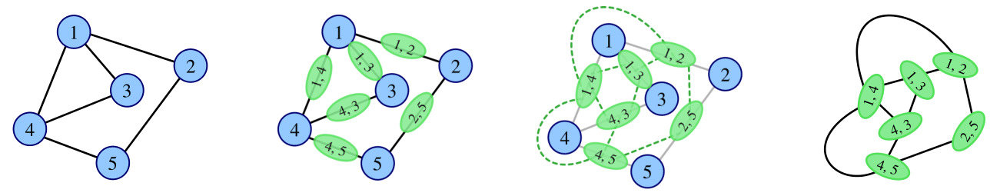

## 题目描述

时间限制：2.0 秒；内存限制：512 MB。

在图论中，简单无向图 $G$ 的线图 $L(G)$ 是另一个简单无向图，它表示了 $G$ 中每两条边之间的邻接关系。

确切地说，对于一个没有自环或重边的无向图 $G$，其线图 $L(G)$ 是一个满足以下条件的图：

-   $L(G)$ 的每个顶点代表 $G$ 的一条边；且
-   $L(G)$ 的两个顶点相邻，当且仅当它们在 $G$ 中对应的边共享一个公共端点。



图：线图的生成

给定一个简单无向图 $G$，你需要求出序列 $L^0(G), L^1(G), \dots, L^{k-1}(G)$ 中所有图的顶点数的最小值，其中 $L^0(G) = G$，且对于每个正整数 $t$，有 $L^t(G) = L(L^{t-1}(G))$。

## 输入格式

输入包含多个测试用例。第一行包含一个整数 $T$ ($1 \le T \le 10^5$)，表示测试用例的数量。

对于每个测试用例： 第一行包含三个整数 $n$ ($1 \le n \le 10^5$)，$m$ ($0 \le m \le \min(\frac{n(n-1)}{2}, 10^5)$) 和 $k$ ($1 \le k \le 10^5$)，分别表示图 $G$ 的顶点数、边数以及线图序列的长度。

接下来 $m$ 行，每行包含两个整数 $u$ 和 $v$ ($1 \le u, v \le n$)，表示图 $G$ 中连接第 $u$ 个顶点和第 $v$ 个顶点的无向边。保证图 $G$ 不包含自环或重边。

保证所有测试用例的顶点总数和边总数分别不超过 $10^5$。

## 输出格式

对于每个测试用例，输出一行，包含一个整数，表示序列 $L^0(G), L^1(G), \dots, L^{k-1}(G)$ 中所有图的顶点数的最小值。

## 样例

### 输入 1

```text
4
5 5 3
1 2
1 3
1 4
2 5
4 5
5 4 3
1 2
1 3
1 4
1 5
5 4 3
1 2
2 3
3 4
4 5
5 0 3
```

### 输出 1

```text
5
4
3
0
```
