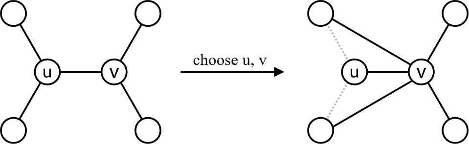

## 题目描述

时间限制：1.0 秒；内存限制：512 MB。

Alice 和 Bob 拥有一棵具有 $n$ 个顶点的树，顶点编号从 $1$ 到 $n$。他们决定在这棵树上轮流进行游戏，Alice 先手。在每次操作中，他们可以选择两个相邻的顶点 $u$ 和 $v$，并将所有连接到 $u$ 的边（连接 $u$ 和 $v$ 的边除外）改为连接到 $v$。简而言之，操作后，每条满足 $w \neq v$ 的边 $(u, w)$ 都会变为 $(v, w)$。



图：“嫁接与移植”操作

然而，他们很快意识到这样的操作可能会导致游戏永远无法结束，因此他们增加了一条额外规则：操作前后的两棵树不能同构。更正式地说，设 $V(S)$ 为树 $S$ 的顶点集，$V(T)$ 为树 $T$ 的顶点集。如果存在一个双射 $f : V(S) \to V(T)$，使得对于 $V(S)$ 中的所有顶点对 $(u, v)$，$u$ 和 $v$ 在 $S$ 中有边相连当且仅当 $f(u)$ 和 $f(v)$ 在 $T$ 中有边相连，则称树 $S$ 和树 $T$ 同构。即 $f(s) = t$ 意味着 $S$ 中的顶点 $s$ 对应于 $T$ 中的顶点 $t$。

在这种情况下，当一名玩家无法进行任何有效操作时，另一名玩家获胜。假设 Alice 和 Bob 都足够聪明，并且会采取最佳策略来获胜，或者在无法获胜时阻止对手获胜，你需要预测获胜者。

## 输入格式

第一行包含一个整数 $n$ ($2 \le n \le 50$)，表示树的顶点数。 接下来 $n-1$ 行，每行包含两个整数 $u$ 和 $v$ ($1 \le u, v \le n$)，表示连接顶点 $u$ 和 $v$ 的无向边。保证给定的边构成一棵树。

## 输出格式

如果 Alice 将赢得游戏，输出 “Alice”；如果 Bob 将赢得游戏，输出 “Bob”；如果即使在增加额外规则的情况下，双方都采取最优策略，游戏仍永远不会结束，则输出 “Draw”。

## 样例

### 样例输入 1

```text
4
1 2
2 3
3 4
```

### 样例输出 1

```text
Alice
```

### 样例输入 2

```text
4
1 2
1 3
1 4
```

### 样例输出 2

```text
Bob
```
