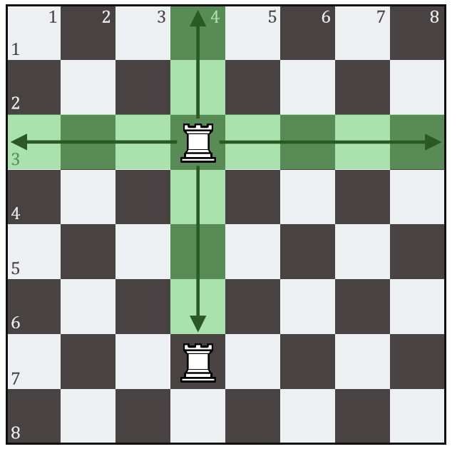
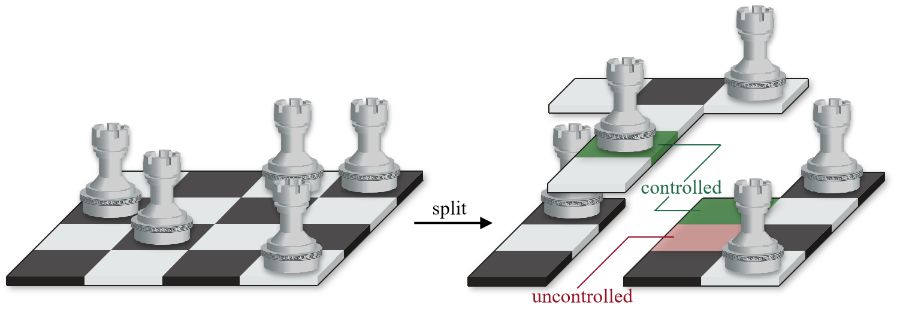

## 题目描述

时间限制：3.0 秒；内存限制：512 MB。

这是一个交互式问题。

考虑一个 $n \times n$ 的棋盘，行从上到下编号为 $1$ 到 $n$，列从左到右编号为 $1$ 到 $n$。位于第 $x$ 行第 $y$ 列的方格记作 $(x, y)$，该方格要么为空，要么被一个中立的棋子（车）占据。根据国际象棋规则，车可以在一行或一列中移动任意数量的方格，但不能跳过其他棋子。在此场景中，车的控制区域由它所占据的方格以及它一步能到达的方格组成。



图 1：位于 (3,4) 的车的控制区域

当且仅当一个方格属于一个或多个控制区域时，称该方格被“控制”。已知信息是所有方格最初都被控制，因此显然棋盘上至少有 $n$ 个车。然而，你不知道每个方格是空的还是被车占据。你的任务是通过不超过 $\lceil \log_2 n \rceil + 2$ 次查询，定位至少 $n$ 个隐藏的车。

在每次查询中，你需要通过确定哪些方格组成上层，哪些方格组成下层，将棋盘划分为两个层级。车只允许在它们所属的层级内移动，它们可以跳过空隙，但不能跳过同一层级中的其他棋子。控制区域和受控方格的定义保持不变。作为响应，交互器将告知你划分后每个方格是否被控制。然后，棋盘将恢复到初始状态。



图 2：将 T 型上层从棋盘中分离出来

你可以假设所有车的位置是预先固定好的。再次注意，当实际车数大于 $n$ 时，不需要找到所有的车。

## 交互

第一行包含一个整数 $T$ ($1 \le T \le 10^4$)，表示测试用例的数量。

每个测试用例的第一行包含一个整数 $n$ ($3 \le n \le 500$)，表示棋盘的大小。保证 $n \ge 10$ 的测试用例数量不超过 $5$ 个。

要发起交互行为，你应该首先在一行中打印一个字符 $opt$ ($opt \in \{ \text{'?'} , \text{'!'} \}$)，然后打印一个 $n \times n$ 的二进制矩阵（共 $n$ 行，每行包含一个二进制字符串）。打印二进制矩阵后，请务必刷新输出。在 C++ 中使用 `fflush(stdout)` 或 `cout.flush()`，在 Java 中使用 `System.out.flush()`，或在 Python 中使用 `stdout.flush()`。

$opt = \text{'?'}$ 表示进行一次查询。如果你的二进制矩阵中第 $x$ 行第 $y$ 列的字符为 '1'，则方格 $(x, y)$ 将组成上层，否则它将组成下层。交互器将返回一个整数 $code$ ($code \in \{0, 1\}$)。如果 $code = 1$，你将得到 Wrong Answer，因为你的查询次数超过了 $\lceil \log_2 n \rceil + 2$。如果 $code = 0$，你将从交互器接收到另一个 $n \times n$ 的二进制矩阵。如果接收到的二进制矩阵中第 $x$ 行第 $y$ 列的字符为 '1'，则方格 $(x, y)$ 在划分后是被控制的，否则它是未被控制的。

$opt = \text{'!'}$ 表示回答车的位置。如果你的二进制矩阵中第 $x$ 行第 $y$ 列的字符为 '1'，则在你的判断中方格 $(x, y)$ 被车占据，否则该方格是否为空或被车占据不会影响对你答案的验证。交互器将返回一个整数 $code$ ($code \in \{0, 1\}$)。如果 $code = 1$，你将得到 Wrong Answer，因为你的答案未能匹配实际的车的位置，或者你没有找到足够数量的车。如果 $code = 0$，如果当前测试用例不是最后一个，你将进入下一个测试用例。

如果你尝试打印既不是 '?' 也不是 '!' 的 $opt$，或者如果你的二进制矩阵格式错误（例如某些 $n$ 行的长度不为 $n$，或者包含既不是 '0' 也不是 '1' 的字符），交互器将返回 $code = -1$，你也将得到 Wrong Answer。

当你收到除 $0$ 以外的任何 $code$ 时，请立即终止程序，以避免出现意外的判决结果。

## 样例

### 输入 1

```text
1
3
0
110
111
111
0
111
111
101
0
```

### 输出 1

```text
?
101
000
101
?
111
100
100
!
010
001
100
```

## 说明

样例中的空行是为了增加可读性。在你的输出中，额外的空格或空行将被忽略。
