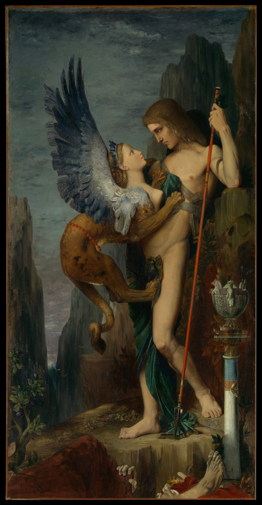

## 题目描述

时间限制：2 秒；内存限制：2048 MB。

埃及最著名的地标之一是吉萨大狮身人面像，这是一座描绘神话生物的雕像，它有着人的头、狮子的身体和鹰的翅膀。在埃及和希腊神话中，狮身人面像被视为守护者。最著名的狮身人面像可能就是那位守护希腊底比斯城的守护者。根据神话，当俄狄浦斯试图进入该城时，狮身人面像给了他这样一个谜题：“哪种生物早晨四条腿，中午两条腿，晚上三条腿，却只有一个声音？”正如你可能听说过的那样，俄狄浦斯正确地回答道：“人——婴儿时期爬行，成年后用双脚行走，老年时使用拐杖。”

在这个问题中，你遇到了另一只狮身人面像，她给出了一个稍微反转的谜题：“一只 axex、一只 basilisk 和一只 centaur 分别有多少条腿？”虽然你认出这些是埃及和希腊神话中的生物，但你不知道每种生物有多少条腿（只知道它们是非负整数）。狮身人面像严厉地指示你不要触碰任何东西，因此你无法用手机搜索答案。

然而，狮身人面像允许你问她五个问题。在每个问题中，你可以询问狮身人面像这些生物总共有多少条腿。例如，你可以问：“三只 basilisk 和一只 axex 总共有多少条腿？”或者“五只 centaur 总共有多少条腿？”你觉得这似乎很简单，但随后你记起狮身人面像是狡猾的生物：狮身人面像的五个答案中可能有一个是彻头彻尾的谎言，而你并不知道是哪一个。

编写一个程序与狮身人面像对话，提出五个问题，并解开这个谜题。

## 交互

共有五轮提问。在每一轮提问中，你必须首先输出一行，包含三个空格分隔的整数 $a, b, c$ ($0 \le a, b, c \le 10$)，代表问题“$a$ 只 axex、$b$ 只 basilisk 和 $c$ 只 centaur 总共有多少条腿？”。提问后，标准输入将提供一个整数 $r$ ($0 \le r \le 10^5$)，作为狮身人面像对你问题的回答。

在五轮提问结束后，输出一行，包含三个空格分隔的非负整数 $l_a, l_b, l_c$，分别表示一只 axex、一只 basilisk 和一只 centaur 的腿的数量。



Oedipus and the Sphinx by Gustave Moreau, 1864, public domain

## 样例

### 样例 1

```text
1 1 1
12
1 1 1
13
5 0 1
24
1 0 0
4
1 1 0
8
4 4 4
```

### 样例 2

```text
4 4 4
2023
1 0 0
0
0 1 0
42
0 0 1
2024
0 0 0
0
0 42 2024
```
