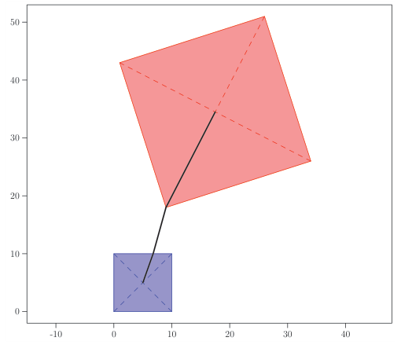

## 题目描述

时间限制：1 秒；内存限制：2048 MB。

蚂蚁 Carl 又回来了！在走过蜿蜒曲折的路径（2004 年世界总决赛 A 题）并在八面体上漫步（2009 年世界总决赛 C 题）之后，是时候去度个小假了——去看看风景！还有什么地方比高大建筑（比如金字塔！）的顶端更适合看风景呢？还有什么地方比埃及更适合看高大的金字塔呢！！！（这太令人兴奋了！！！！！）

在欣赏完一座金字塔顶端的风景后，Carl 想去另一座金字塔的顶端。由于蚂蚁在烈日下表现不佳，他想找到在两座金字塔顶端之间行走的最小距离，假设他只能在金字塔的表面以及金字塔所在的平面上行走。这些金字塔在几何上是正四棱锥，这意味着金字塔的顶点位于正方形底座中心的垂直上方。



图 D.1：对应样例输入 1 的两座金字塔示意图。黑线表示两座金字塔顶点之间的最短路径。

## 输入格式

输入的第一行包含五个整数 $x_1, y_1, x_2, y_2, h$，其中 $x_1, y_1, x_2, y_2$（$-10^5 \le x_1, x_2, y_1, y_2 \le 10^5$ 且 $(x_1, y_1) \neq (x_2, y_2)$）定义了第一座金字塔的一条边，金字塔的主体位于从 $(x_1, y_1)$ 到 $(x_2, y_2)$ 的有向向量的左侧，$h$（$1 \le h \le 10^5$）是金字塔的高度。 输入的第二行以相同的格式描述了第二座金字塔。两座金字塔底座的交集面积为 0。

## 输出格式

输出 Carl 在两座金字塔顶点之间行走的最小距离。你的答案应具有不超过 $10^{-6}$ 的绝对或相对误差。

## 样例

### 输入 1

```text
0 0 10 0 4
9 18 34 26 42
```

### 输出 1

```text
60.866649532
```
