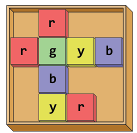
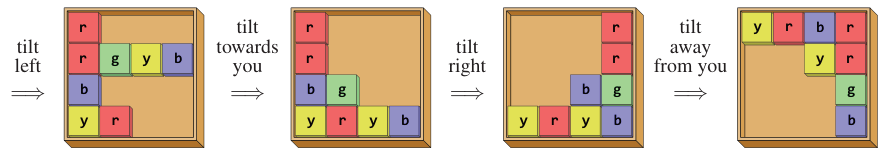

## 题目描述

时间限制：3 秒；内存限制：2048 MB。

你在阁楼的旧玩具箱里发现了一个奇怪的拼图。该拼图由一个 $h \times w$ 的矩形网格板组成。网格中的某些单元格放置有彩色瓷砖，如图 F.1 所示。



图 F.1：彩色瓷砖对应样例输入 1 中的初始排列。

你还不确定这个拼图的确切目标是什么，但你开始研究重新排列瓷砖的可能方法。可以通过向四个基本方向之一倾斜网格来操纵它们的排列：向左、向右、向你（下）或远离你（上）。倾斜会导致所有瓷砖沿相应方向滑动，直到被边界或另一个瓷砖挡住。给定一个初始排列和一个结束排列，确定是否存在某种倾斜序列可以将前者转换为后者。图 F.2 展示了样例输入 1 中拼图的倾斜过程。



图 F.2：样例输入 1 的解法。

## 输入格式

输入的第一行包含两个整数 $h$ 和 $w$ ($1 \le h, w \le 500$)，表示网格的高度和宽度。接下来 $h$ 行给出了从顶行到底行的初始排列。这些行中的每一行都包含一个长度为 $w$ 的字符串，描述了该行从左到右的单元格。如果单元格为空，则对应字符为点（`.`）。如果有瓷砖，则给出该瓷砖的颜色，用小写字母（`a-z`）表示。不同的字母代表不同的颜色，相同颜色的瓷砖无法区分。

在初始排列之后，有一个空行，接着是结束排列的描述，格式与初始排列相同。

## 输出格式

如果存在一个倾斜序列可以将初始排列转换为结束排列，则输出 `yes`，否则输出 `no`。

## 样例

### 输入 1

```text
4 4
.r..
rgyb
.b..
.yr.

yrbr
..yr
...g
...b
```

### 输出 1

```text
yes
```

### 输入 2

```text
1 7
....x..
..x....
```

### 输出 2

```text
no
```

### 输入 3

```text
4 3
yr.
..b
ry.
b..

...
..b
.ry
byb
```

### 输出 3

```text
no
```
