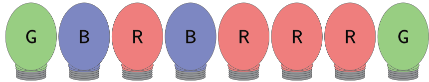

## 题目描述

时间限制：3 秒；内存限制：2048 MB。

Mei 的父母在过去的一年里重新装修了房子，但他们的照明系统非常复杂！房子里的每个房间都有一盏 LED 灯，可以设置为红色、绿色或蓝色，如图 G.1 所示。



图 G.1：样例输入 1 中灯的初始状态。未显示按钮和电线。

房子里有各种各样的按钮，每个按钮都连接着一盏或多盏灯。当按下某个按钮时，连接到该按钮的任何红色灯都会变成绿色，任何绿色灯都会变成蓝色，任何蓝色灯都会变成红色。每个按钮都可以被多次按下。由于房子是在交叉开关布线发明之前建造的，因此每盏灯最多由两个按钮控制。

Mei 最喜欢的颜色是红色，所以她想把所有的灯都变成红色。她的父母担心按钮会磨损，要求她尽量减少按钮按下的总次数。

## 输入格式

第一行包含两个正整数 $l$ 和 $b$，其中 $l$ ($1 \le l \le 2 \cdot 10^5$) 是灯的数量，$b$ ($0 \le b \le 2 \cdot l$) 是按钮的数量。第二行输入是一个长度为 $l$ 的字符串，由 R、G 或 B 组成，其中第 $i$ 个字符是第 $i$ 盏灯的初始颜色。接下来的 $b$ 行描述了按钮。每行以一个整数 $k$ ($1 \le k \le l$) 开头，表示该按钮控制的灯的数量。随后是 $k$ 个不同的整数，表示该按钮控制的灯。灯的编号从 1 到 $l$（包含 1 和 $l$）。每盏灯在所有按钮中最多出现两次。

## 输出格式

输出 Mei 将所有灯变为红色所需的最少按钮按下次数。如果 Mei 不可能将所有灯都变为红色，则输出 `impossible`。

## 样例

### 样例输入 1

```text
8 6
GBRBRRRG
2 1 4
1 2
4 4 5 6 7
3 5 6 7
1 8
1 8
```

### 样例输出 1

```text
8
```

### 样例输入 2

```text
4 3
RGBR
2 1 2
2 2 3
2 3 4
```

### 样例输出 2

```text
impossible
```

### 样例输入 3

```text
4 4
GBRG
2 1 2
2 2 3
2 3 4
1 4
```

### 样例输出 3

```text
6
```

### 样例输入 4

```text
3 3
RGB
1 1
1 2
1 3
```

### 样例输出 4

```text
3
```
