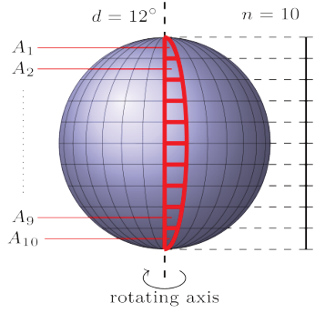

## 题目描述

时间限制：3 秒；内存限制：2048 MB。

近年来，太阳系外发现了数以千计的行星。对于潜在的生命支持系统而言，液态水的存在是一个重要因素。探测遥远行星上的水并不容易。对于旋转的行星，一种使用相对论量子极化光谱学的新技术可以提供帮助。其工作原理如下（这是一个简化的描述，因为在这个星球上只有三个人真正理解它是如何工作的）。

假设望远镜显示的行星其旋转轴是垂直的，赤道是水平的。只有图像中心处的垂直线（覆盖旋转轴的线）会被分析，因为它提供了行星表面最高的分辨率。

分析过程以 $d$ 度为步长进行。在每一步中，当行星旋转 $d$ 度时，数据会被聚合，因此每一步都能提供关于行星表面 $d$ 度切片的信息。图像被分割成 $n$ 个等高的部分，这些部分被分别分析。因此，这个 $d$ 度的切片被划分为 $n$ 个区域 $A_1, \dots, A_n$。对于每个区域 $A_i$，图像分析会得出一个数值，表示 $A_i$ 被水覆盖的百分比。右图中高亮显示了某一步的区域 $A_i$。



你可以假设行星表面是一个球体。这意味着每个区域 $A_2, \dots, A_{n-1}$ 都是一个球面四边形：它有四个顶点，两条边平行于赤道（即在平行于赤道平面的平面上），另外两条边位于穿过行星两极的大圆上，且这两个大圆相隔 $d$ 度。在两极处，四个顶点中的两个会重合于极点，因此 $A_1$ 和 $A_n$ 是只有一条边平行于赤道的球面三角形。由于表面的曲率，平行于赤道的边在靠近赤道时更长，而位于大圆上的边在靠近两极时更长。

上述过程重复进行，每次旋转 $d$ 度，总共重复 $m$ 次，直到行星的整个表面都被覆盖（即 $md = 360$ 度）。你的任务是根据给定的数据计算行星表面被水覆盖的百分比。

## 输入格式

输入的第一行包含两个整数 $n$ 和 $m$ ($2 \le n, m \le 1000$)。接下来的 $n$ 行，每行包含 $m$ 个整数 $a_{i,j}$ ($0 \le a_{i,j} \le 100$，其中 $1 \le i \le n$ 且 $1 \le j \le m$)。该矩阵的每一列描述了单步测量的数据，即旋转 $d$ 度的情况。数字 $a_{i,j}$ 表示在第 $j$ 步中区域 $A_i$ 被水覆盖的百分比。

## 输出格式

输出行星表面被水覆盖的百分比。你的答案应具有不超过 $10^{-6}$ 的绝对误差。

## 样例

### 输入格式 1

```text
3 7
63 61 55 54 77 87 89
73 60 38 5 16 56 91
75 43 11 3 16 20 95
```

### 输出格式 1

```text
51.809523810
```

### 输入格式 2

```text
4 3
10 10 10
10 10 10
10 10 10
10 10 10
```

### 输出格式 2

```text
10.000000000
```
