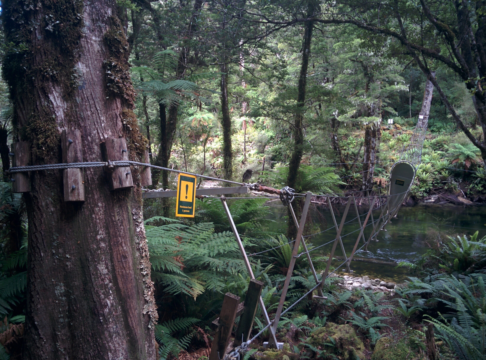

## 题目描述

时间限制：4 秒；内存限制：2048 MB。

一群行人夜间来到河边。他们想要过一座桥，这座桥一次只能容纳有限数量的行人。行人们只有一支手电筒，过桥时必须使用。每位行人过桥需要一定的时间；一组人一起过桥时，必须以其中最慢的行人的速度行进。请问所有行人过桥所需的最短时间是多少？

例如，样例输入 1 假设桥一次可以容纳 2 名行人，共有 4 名行人，过桥时间分别为 1 分钟、2 分钟、5 分钟和 10 分钟。通过以下过桥顺序，可以实现 17 分钟的最短时间：首先，两名最快的行人过桥，耗时 2 分钟。其次，最快的行人返回，耗时 1 分钟。第三，两名最慢的行人过桥，耗时 10 分钟。第四，第二快的行人返回，耗时 2 分钟。第五，两名最快的行人过桥，耗时 2 分钟。



低承载力的桥

## 输入格式

输入的第一行包含两个整数 $n$ 和 $c$，其中 $n$ ($2 \le n \le 10^4$) 是行人的数量，$c$ ($2 \le c \le 10^4$) 是桥一次可以容纳的行人数量。

接下来一行包含 $n$ 个整数 $t_1, \dots, t_n$ ($1 \le t_i \le 10^9$，对于所有 $i$)。第 $i$ 位行人过桥需要的时间为 $t_i$。

## 输出格式

输出整个团队过桥所需的最短总时间。

## 样例

### 样例输入 1

```text
4 2
1 2 10 5
```

### 样例输出 1

```text
17
```

### 样例输入 2

```text
4 6
1 2 10 5
```

### 样例输出 2

```text
10
```
