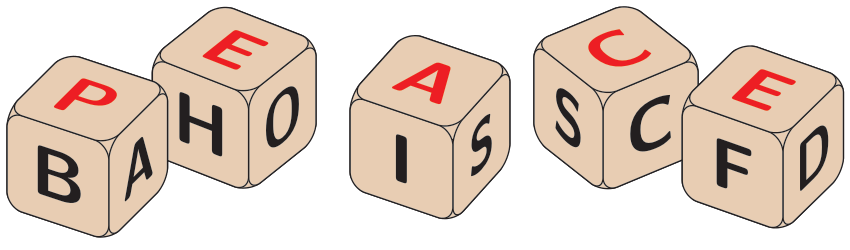

## 题目描述

时间限制：10 秒；内存限制：2048 MB。

你正在玩一个有多枚公平六面骰子的游戏。每枚骰子的面上都显示一个符号。游戏的目标是掷骰子，并用每枚骰子顶部的符号组成一个有效的单词。如果你无法组成一个单词，你可以重新掷骰子进行下一次尝试。



图 K.1：五枚骰子组成了一个对应于样例输入 1 的有效单词。

假设有五枚骰子：其中一枚包含字母 A, B, C, D, E 和 P（简写为 ABCDEP），其他骰子分别包含 AEHOXU, AISOLR, ABCDEF 和 ABCSCC。第一次投掷后，各骰子顶部的字母分别为：P, X, R, E 和 S。由于无法将这些字母排列成一个有效的单词，你决定保留 P, S 和 E，并重新投掷其他骰子，试图组成像 PARSE, PAUSE, PHASE, POISE, PROSE, PULSE 或 PURSE 这样的单词。这两枚骰子掷出了 E 和 A，结果得到以下五个字母：P, E, A, E 和 S。你仍然想不出一个有效的单词，所以你决定保留四个字母，只重新投掷最后一枚有三个面是字母 C 的骰子。通过这样做，有 50% 的概率可以组成最终的有效单词：PEACE，如图 K.1 所示。

当你掷一枚骰子时，它以相等的概率落在任何一个面上。假设你使用最优策略，组成一个有效单词所需的期望投掷次数是多少？

## 输入格式

输入的第一行包含两个数字 $d$ 和 $w$，其中 $d$ ($1 \le d \le 6$) 是骰子的数量，$w$ ($1 \le w \le 2 \cdot 10^5$) 是字典中有效单词的数量。接下来的 $d$ 行，每行包含 6 个符号，代表骰子每个面上的符号。最后的 $w$ 行包含字典中 $w$ 个不同的有效单词。每个单词恰好有 $d$ 个符号。

输入中的所有符号要么是大写字母 (A–Z)，要么是数字 (0–9)。

## 输出格式

如果可以组成一个有效单词，输出使用最优策略时组成一个有效单词所需的期望投掷次数。否则，输出 `impossible`。你的答案应具有至少 $10^{-6}$ 的绝对或相对误差。

## 样例

### 样例输入 1

```text
5 8
ABCDEP
AEHOXU
AISOLR
ABCDEF
ABCSCC
PARSE
PAUSE
PHASE
POISE
PROSE
PULSE
PURSE
PEACE
```

### 样例输出 1

```text
9.677887141
```

### 样例输入 2

```text
2 1
AAAAAA
BBBBBB
AB
```

### 样例输出 2

```text
1.0
```

### 样例输入 3

```text
3 1
123456
123456
123456
666
```

### 样例输出 3

```text
10.555444555
```

### 样例输入 4

```text
2 1
ABCDEF
GHI234
AB
```

### 样例输出 4

```text
impossible
```
