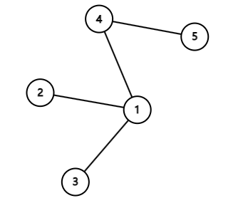
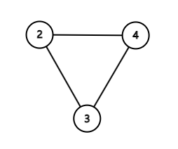
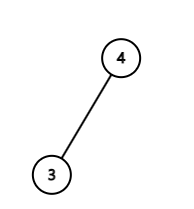
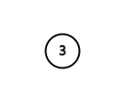

> QOJ 将此版本标注为 AI 翻译，可能存在不准确之处；有疑问时请核对原文。

## 题目描述

时间限制：1 秒；内存限制：1024 MB。

给定一个包含 $n$ 个顶点（编号从 $1$ 到 $n$）和 $n-1$ 条边的图。保证初始时任意两点之间均可达，即该图实际上是一棵树。你非常讨厌树，所以决定删掉它！

然而，你只允许执行以下操作：选择一些当前存在的顶点。这些被选中的顶点之间不能有边相连。对于每个被选中的顶点 $v$，在 $v$ 的所有当前邻居之间添加边（当且仅当存在连接 $u$ 和 $v$ 的边时，称顶点 $u$ 是 $v$ 的邻居），然后删除被选中的顶点及其所有关联边（当且仅当 $v$ 是边 $e$ 的端点之一时，称边 $e$ 与 $v$ 关联）。可以证明，在每次操作中，对被选中的顶点执行上述操作的顺序不会影响结果。同时请注意，该操作可能会在图中引入重边。

你最多可以执行此操作 $10$ 次。请输出一个操作序列，使得所有顶点在操作后都被删除。如果存在多种可能的操作序列，输出任意一种即可。可以证明至少存在一种可行的操作方案。

## 输入格式

第一行包含一个整数 $n$ ($3 \le n \le 500$)，表示初始图中的顶点数。

接下来 $n-1$ 行，第 $i$ 行 ($1 \le i \le n-1$) 包含两个整数 $x_i, y_i$ ($1 \le x_i < y_i \le n$)，表示初始图中连接顶点 $x_i$ 和 $y_i$ 的一条边。

保证对于任意 $1 \le i < j < n$，满足 $x_i \neq x_j$ 或 $y_i \neq y_j$。

## 输出格式

第一行包含一个整数 $m$，表示操作次数。你需要确保 $0 \le m \le 10$。

接下来 $m$ 行，第 $i$ 行描述第 $i$ 次操作：第一个整数 $k$ 表示该次操作中选中的顶点数量，随后是同一行中用空格分隔的 $k$ 个不同的整数，表示该次操作中选中的顶点标签。

## 样例

### 输入 1

```text
5
1 2
1 3
1 4
4 5
```

### 输出 1

```text
4
2 1 5
1 2
1 4
1 3
```

## 说明

第一个样例输出对应的操作过程如下所示。

第一步操作前，图的形态如下：



第一步操作后，图的形态如下：



第二步操作后，图的形态如下：



第三步操作后，图的形态如下：


