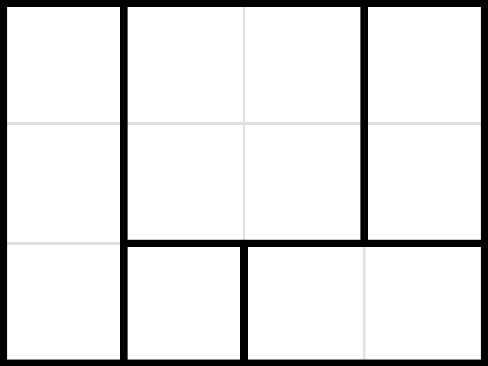

> QOJ 将此版本标注为 AI 翻译，可能存在不准确之处；有疑问时请核对原文。

## 题目描述

时间限制：2 秒；内存限制：512 MB。

有一个 $n$ 行 $m$ 列的矩形网格，其中网格内部的一些边已被移除。该网格满足以下性质：内部的每一个封闭形状都是一个矩形，且每个矩形内部没有额外的边，如下图所示。



你可以执行以下操作：选择两个矩形，如果它们合并后能形成另一个矩形（即一个矩形的底边与另一个矩形的顶边重合，或者一个矩形的右边与另一个矩形的左边重合），则将它们合并为一个矩形（这意味着它们之间重叠的边被移除）。

请问，是否可以通过一系列操作，使得最终只剩下一个高度为 $n$、宽度为 $m$ 的矩形，即整个网格内部不再有任何边？

## 输入格式

第一行包含两个整数 $n, m$ ($3 \le n, m \le 1500$)，表示矩形网格的大小。

接下来 $n - 1$ 行，每行包含一个长度为 $m$ 的二进制字符串。第 $i$ 行的第 $j$ 个字符表示第 $i$ 行第 $j$ 列的单元格与第 $i+1$ 行第 $j$ 列的单元格之间是否存在边（$0$ 表示无，$1$ 表示有）。

接下来 $n$ 行，每行包含一个长度为 $m - 1$ 的二进制字符串。第 $i$ 行的第 $j$ 个字符表示第 $i$ 行第 $j$ 列的单元格与第 $i$ 行第 $j+1$ 列的单元格之间是否存在边（$0$ 表示无，$1$ 表示有）。

## 输出格式

如果存在一系列操作使得最终只剩下一个高度为 $n$、宽度为 $m$ 的矩形，则输出 “YES”（不含引号），否则输出 “NO”（不含引号）。

## 样例

### 样例输入 1

```text
3 4
0000
0111
101
101
110
```

### 样例输出 1

```text
YES
```

### 样例输入 2

```text
3 3
110
011
01
11
10
```

### 样例输出 2

```text
NO
```
