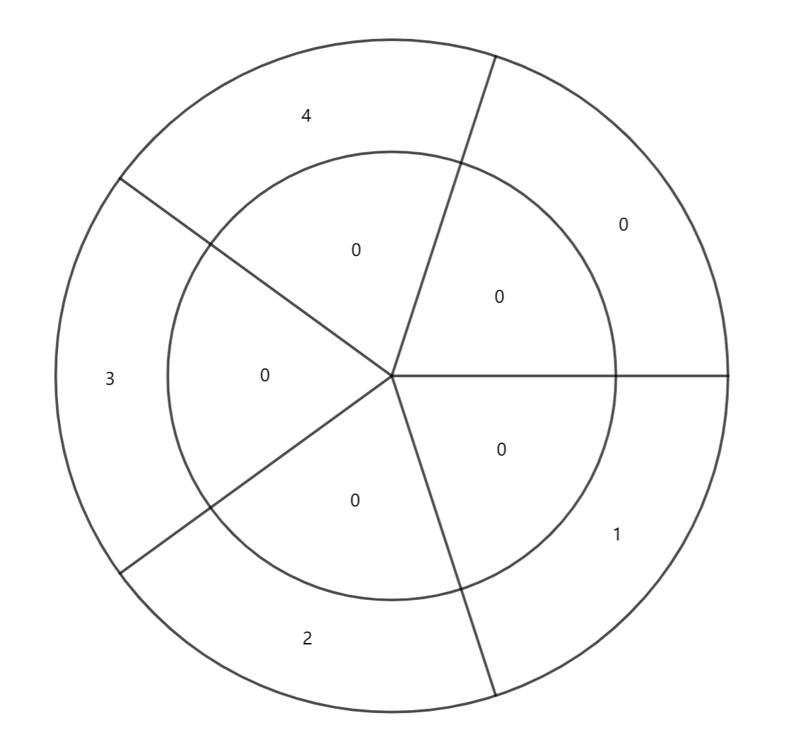
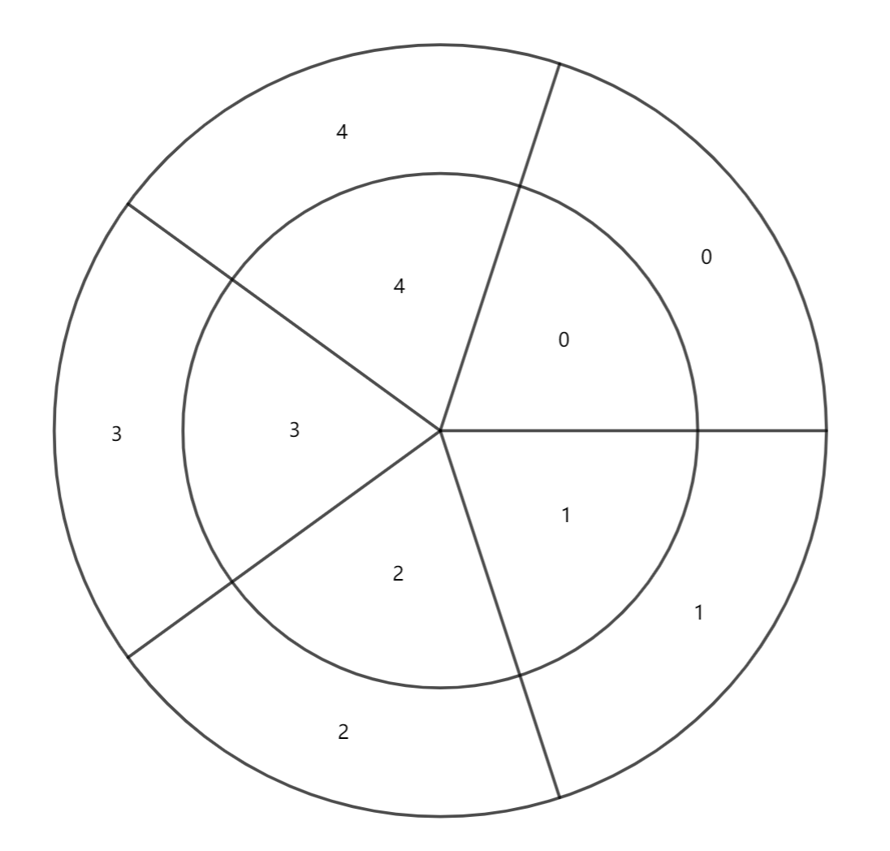
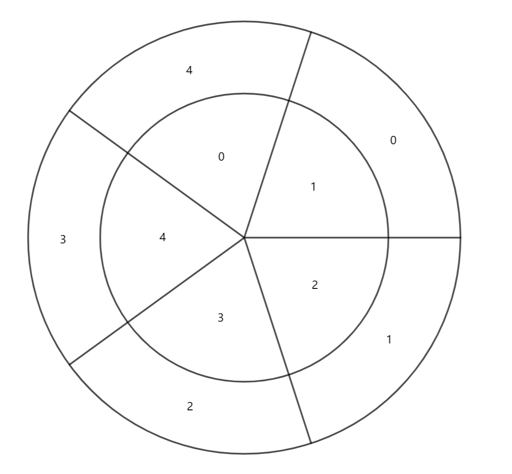
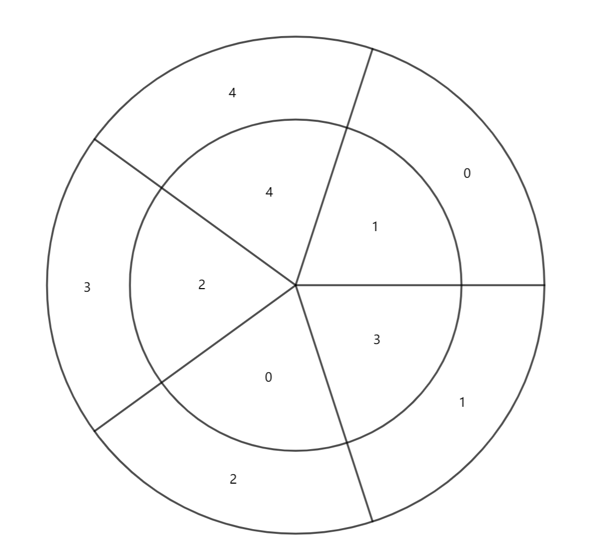

> QOJ 将此版本标注为 AI 翻译，可能存在不准确之处；有疑问时请核对原文。

## 题目描述

时间限制：1 秒；内存限制：512 MB。

有一个旋转轮，由内轮和外轮组成，两者都被分成 $n$ 个相等的扇区。内轮的扇区与外轮的扇区一一对应。你可以旋转内轮，但外轮必须保持固定。外轮的 $n$ 个扇区上顺时针依次写有数字 $0, 1, \dots, n-1$，而内轮的所有 $n$ 个扇区初始时都写着数字 $0$。我们将外轮上写有数字 $i$ ($0 \le i \le n-1$) 的扇区称为外轮的第 $i$ 个扇区。

你可以执行两种操作： 1. 旋转（内）轮。旋转后，内轮的所有扇区必须仍然与外轮的扇区一一对应。 2. 对于内轮上的每一个扇区，将其上的数字加上其对应外轮扇区上的数字。如果结果大于或等于 $n$，则减去 $n$。

给定 $n$ 和 $a_0, a_1, \dots, a_{n-1}$，求出使内轮上对应外轮第 $i$ 个扇区的扇区上的数字等于 $a_i$ 所需的最少操作次数，或者确定这是不可能的。

## 输入格式

第一行包含一个整数 $n$ ($3 \le n \le 10^5$)，表示内轮和外轮上的扇区数量。

下一行包含 $n$ 个整数 $a_0, a_1, \dots, a_{n-1}$ ($0 \le a_i < n$)，表示内轮上对应外轮第 $i$ 个扇区的扇区上的目标数字。

## 输出格式

输出一行一个数字，表示使内轮上对应外轮第 $i$ 个扇区的扇区上的数字等于 $a_i$ 所需的最少操作次数。如果无法做到，则输出 $-1$。

## 样例

### 输入格式 1

```text
5
1 3 0 2 4
```

### 输出格式 1

```text
3
```

### 说明

第一个样例对应的操作过程如下所示。

在第一步之前，旋转轮的图片如下：



我们执行的第一种操作是类型二。在第一步之后，旋转轮的图片如下：



我们执行的第二种操作是类型一。我们选择将其顺时针旋转 $288^\circ$。在第二步之后，旋转轮的图片如下：



我们执行的第三种操作是类型二。在第三步之后，旋转轮的图片如下：


