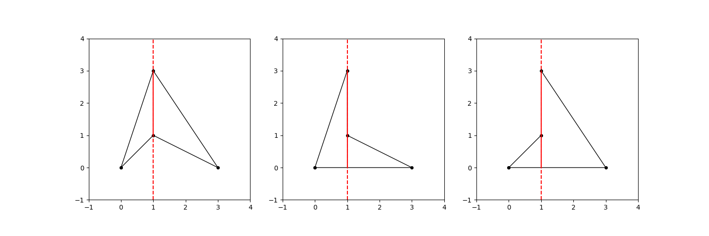

## 题目描述

时间限制：6.0 秒；内存限制：1024 MB。

这是一个交互式问题。

你将获得一个简单多边形，但在给出多边形的 $n$ 个顶点之前，Little Q 已经将它们打乱了。

你可以向 Little Q 询问不超过 $n - 2$ 次查询，每次查询包含三个整数 $a, b$ ($-10^{15} \le a, b \le 10^{15}, a^2 + b^2 > 0$) 和 $c$ ($-2 \times 10^{18} \le c \le 2 \times 10^{18}$)。他会告诉你直线 $ax + by + c = 0$ 在多边形内部或边界上的线段总长度，该长度可以表示为 $r\sqrt{a^2 + b^2}/s$，其中 $r$ 和 $s$ 为两个整数 ($r \ge 0, s \ge 1, \gcd(r, s) = 1$)。这里 $\gcd(r, s)$ 是 $r$ 和 $s$ 的最大公约数。

你需要找到该多边形，并按逆时针顺序输出其顶点。你可以从任意顶点开始。

多边形及其被打乱的顶点顺序在交互开始前就已经确定，且不依赖于你的查询。换句话说，交互器不是自适应的。

## 输入格式

输入的第一行包含一个整数 $T$ ($1 \le T \le 200$)，表示测试用例的数量。对于每个测试用例：

第一行包含一个整数 $n$ ($3 \le n \le 200$)，表示多边形的顶点数。

接下来 $n$ 行，每行包含两个整数 $x$ 和 $y$ ($0 \le x, y \le 1000$)，给出了多边形顶点的坐标 $(x, y)$，顺序已被打乱。

该多边形是简单多边形，即其顶点互不相同，且除相邻边在其公共顶点处相交外，多边形的任意两条边都不相交或接触。此外，没有两条相邻边是共线的。

保证所有测试用例的 $n$ 之和不超过 $200$。

## 交互

如果你想进行一次查询，请输出一行。首先输出 `?`，后跟一个空格，然后输出三个整数 $a, b$ 和 $c$。在刷新输出后，你的程序应读取两个整数 $r$ 和 $s$，这意味着你查询的答案为 $r\sqrt{a^2 + b^2}/s$。

如果你想猜测多边形，请输出 $n + 1$ 行。首先输出 `!`，然后输出 $n$ 行，每行包含两个整数 $x$ 和 $y$，给出多边形顶点的坐标 $(x, y)$，按逆时针顺序排列。你可以从任意顶点开始。在刷新输出后，你的程序应继续处理下一个测试用例，或者在没有更多测试用例时立即退出。注意，你的猜测不计入查询次数。

要刷新输出，你可以使用：

-   在 C 和 C++ 中使用 `fflush(stdout)` (如果你使用 `printf`) 或 `cout.flush()` (如果你使用 `cout`)。
-   在 Java 和 Kotlin 中使用 `System.out.flush()`。
-   在 Python 中使用 `sys.stdout.flush()`。

## 样例

### 输入 1

```text
2
4
0 0
1 3
1 1
3 0
2 1
3
0 0
999 1000
1000 999
1 1000000000000000000000000
```

### 输出 1

```text
? 1 0 -1
!
1 1
3 0
1 3
0 0
? 1000000000000 1000000000000 -1999
!
0 0
1000 999
999 1000
```

## 说明

对于第一个样例，有三个候选多边形，如下图所示。只有最左侧的一个满足对查询 $1 \cdot x + 0 \cdot y + (-1) = 0$ 的答案为 $2$。另外两个对该查询的答案为 $3$。



对于第二个样例，对查询 $10^{12} \cdot x + 10^{12} \cdot y + (-1999) = 0$ 的答案是 $\sqrt{2}/10^{12}$，因此 $r = 1, s = 10^{24}$。只有一个候选多边形。

注意，样例中显示的顶点顺序可能与实际提供的顺序不一致。

样例中的空行是为了增加可读性。在你的输出中，多余的空格或空行将被忽略。
