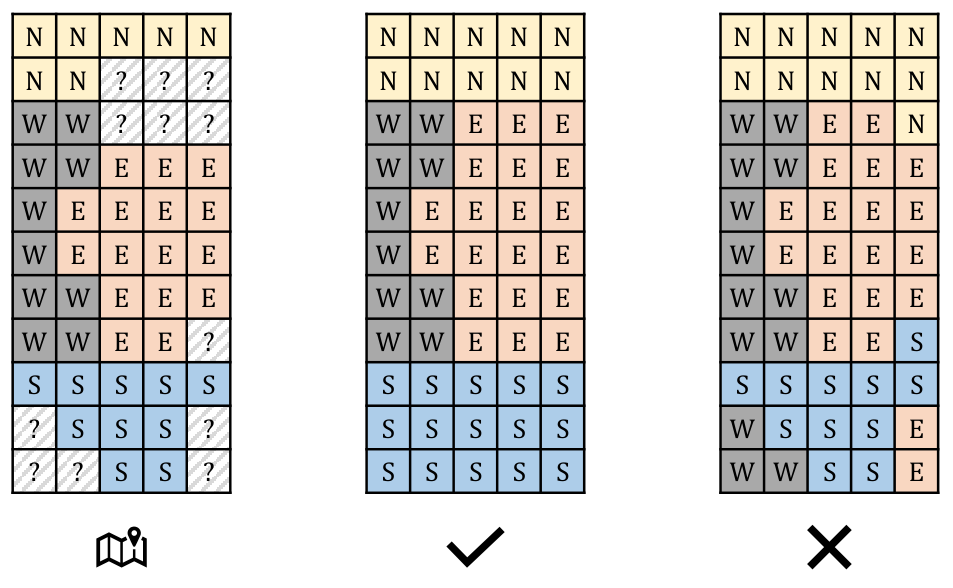

> QOJ 将此版本标注为 AI 翻译，可能存在不准确之处；有疑问时请核对原文。

## 题目描述

时间限制：8.0 秒；内存限制：1024 MB。

有些大学使用坐标系统来命名校园内的建筑物：将校园划分为北、南、西、东四个区域，然后为每栋建筑物分配一个序号以进行枚举和标识。由于历史或地理原因，某些区域可能不连通，甚至可能根本不存在。确保系统一致性的唯一规则如下：

-   对于北区域 (N) 中的每栋建筑物，其正北方的所有建筑物都必须属于北区域。
-   对于南区域 (S) 中的每栋建筑物，其正南方的所有建筑物都必须属于南区域。
-   对于东区域 (E) 中的每栋建筑物，其正东方的所有建筑物都必须属于东区域。
-   对于西区域 (W) 中的每栋建筑物，其正西方的所有建筑物都必须属于西区域。

今天，Aki 参观了一所应用相同命名规则的大学。下午在校园里漫步后，他发现大学里的建筑物排列在一个 $n \times m$ 的网格中，每个单元格内恰好有一栋建筑物。Aki 参观了其中一些建筑物，而其余的仍然未知。基于他目前的知识，Aki 对大学可能的布局数量感到好奇。如果存在一栋建筑物所属的区域不同，则认为两种布局不同。

请参阅下图，该图说明了第一个样例。对于左侧显示的谜题，中间的布局是一个有效的解，而右侧的布局是无效的，因为有些单元格违反了规则。例如，第三行最后三个单元格违反了第三条规则，该规则规定东区域中某栋建筑物正东方的所有建筑物都必须属于东区域。



解决 Aki 的任务。由于答案可能很大，仅需输出答案对 998244353 取模的结果。

## 输入格式

输入包含多个测试用例。第一行包含一个整数 $T$ ($1 \le T \le 100$)，表示测试用例的数量。每个测试用例：

-   第一行包含两个整数 $n$ 和 $m$ ($1 \le n, m \le 1000$)，表示地图的大小。地图包含从北到南的 $n$ 行，以及从西到东的 $m$ 列。左上角为西北角。
-   接下来的 $n$ 行，每行包含一个长度为 $m$ 的字符串。每个字符应为 N、S、W、E 或 ?。

保证所有测试用例的 $n \times m$ 之和不超过 $2 \times 10^6$。

## 输出格式

对于每个测试用例，在一行中输出可能的布局数量，对 998244353 取模。

## 样例

### 输入格式 1

```text
5
11 5
NNNNN
NN???
WW???
WWEEE
WEEEE
WEEEE
WWEEE
WWEE?
SSSSS
?SSS?
??SS?
2 7
??S?N??
??S?N??
3 4
W??E
WEEE
?E??
2 2
??
??
3 3
???
???
???
```

### 输出格式 1

```text
26
1587
18
56
1112
```

### 说明

样例中的第一个测试用例对应于题目描述中图示的谜题。

---

来源：[QOJ 中文题面](https://qoj.ac/problem/9977/statement/zh_cn)。保留 QOJ 提供的中文内容，仅转换为 Markdown 排版；原题及图示版权归原作者所有。 QOJ 中文页中失效或错配的图片已按原有顺序补为[官方英文题面](https://qoj.ac/download.php?type=attachments&id=1894&r=0)中的对应图示。
