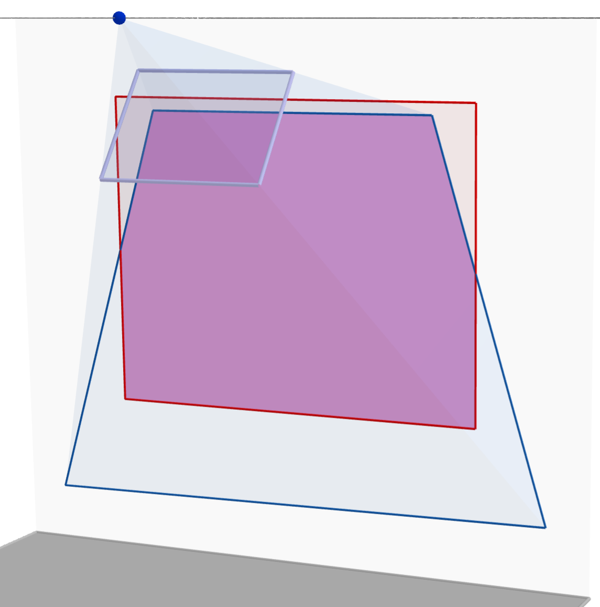
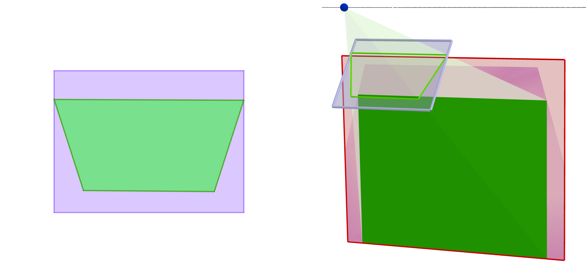

> QOJ 将此版本标注为 AI 翻译，可能存在不准确之处；有疑问时请核对原文。

## 题目描述

时间限制：4.0 秒；内存限制：1024 MB。

作为一个动漫迷，Haru 最近买了一台投影仪，以便在墙上的大屏幕上享受家庭影院。然而，这台投影仪的性价比很高：它价格低廉，功能也仅仅是“能用”。它提供的调节功能有限，且被固定在支架上；因此，经常会出现画面不对齐的情况。幸运的是，它有一个手动梯形校正功能，可以将图像的四个角对齐到给定的点，从而确保输出尽可能接近原始的宽高比。



投影仪不对齐的示例。



梯形校正及最终结果。这是 Haru 对第一个样例的解决方案。

投影仪被描述为一个点光源，以及位于透镜平面上宽度为 $w$、高度为 $h$ 的透镜矩形的四个角。透镜矩形定义了所需画面的宽高比，记为 $w : h$ —— 例如，在实际应用中，简化后的宽高比通常为 $4 : 3$ 或 $16 : 9$。光束由透镜矩形限定，并最终投射到屏幕上，屏幕是墙面上的一个矩形。

Haru 的挑战是为梯形校正获取透镜矩形中的四个锚点，使得校正后的投影是一个矩形，该矩形保持了透镜矩形的宽高比，且其底边（具有最小最大 $z$ 坐标的边）平行于 $xOy$ 平面，并完全落在屏幕内。

厌倦了手动调整墙上的轮廓，Haru 决定编写一个程序来实现梯形校正算法，以计算一个好的投影矩形的最大面积。

## 输入格式

输入包含多个测试用例。第一行包含一个整数 $T$ ($1 \le T \le 1000$)，表示测试用例的数量。对于每个测试用例，共有八行：

-   前四行中，第 $i$ 行包含整数 $x_i, y_i, z_i$ ($|x_i|, |z_i| \le 100, 1 \le y_i \le 100, \max\{x_1, x_4\} < \min\{x_2, x_3\}, \max\{z_1, z_2\} < \min\{z_3, z_4\}$)，表示透镜矩形的一个角 $(x_i, y_i, z_i)$。
-   接下来的四行中，第 $i$ 行包含整数 $u_i, v_i, w_i$ ($|u_i|, |w_i| \le 1000, (\max_{j=1}^4 y_j) < v_i \le 1000, u_1 = u_4 < u_2 = u_3, v_1 = v_4 < v_2 = v_3, w_1 = w_2 < w_3 = w_4$)，表示屏幕矩形的一个角 $(u_i, v_i, w_i)$。

每四个点构成一个矩形，并按左下、右下、右上和左上角的顺序排列（参见上述关于 $x$ 和 $z$ 坐标的约束）。光源位于 $(0, 0, 0)$。设透镜左下角和右下角之间的距离为 $w$，左下角和左上角之间的距离为 $h$。则 $1 \le \frac{w}{h} \le 4$。为了确保投影大致沿着前方（$y$ 轴正方向）进行，还有一些额外的约束：

-   墙面垂直于 $xOy$ 平面，且屏幕的底边平行于 $xOy$ 平面。
-   透镜矩形和点 $(0, 0, 0)$ 都在墙的同一侧，且距离墙至少 1 个单位。图像平面到 $(0, 0, 0)$ 的距离至少为 1 个单位。
-   屏幕底边与 $x$ 轴之间的夹角不超过 $\frac{\pi}{18} = 10^\circ$。透镜底边与 $x$ 轴之间的夹角不超过 $\frac{\pi}{18} = 10^\circ$。
-   光束通过透镜投射到墙面上，照亮面积最大为 $10^6$ 平方单位的区域。屏幕与未校正投影的交集至少为 1 平方单位。

## 输出格式

对于每个测试用例，输出一行，为一个十进制实数，表示答案。如果答案的绝对误差或相对误差不超过 $10^{-6}$，则被视为正确。

## 样例

### 输入 1

```text
2
-20 23 -36
20 23 -36
20 41 -12
-20 41 -12
-50 80 -100
50 79 -100
50 79 -20
-50 80 -20
-1 2 4
1 2 4
1 3 5
-1 3 5
-20 6 0
20 6 0
20 6 20
-20 6 20
```

### 输出 1

```text
5450.0656584647
5.6568542495
```
