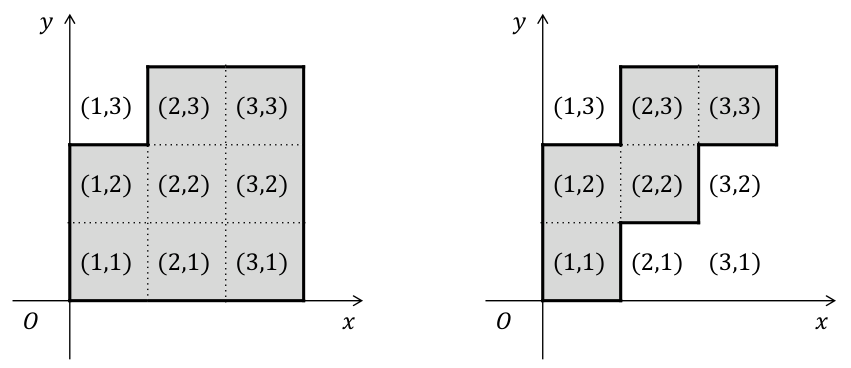
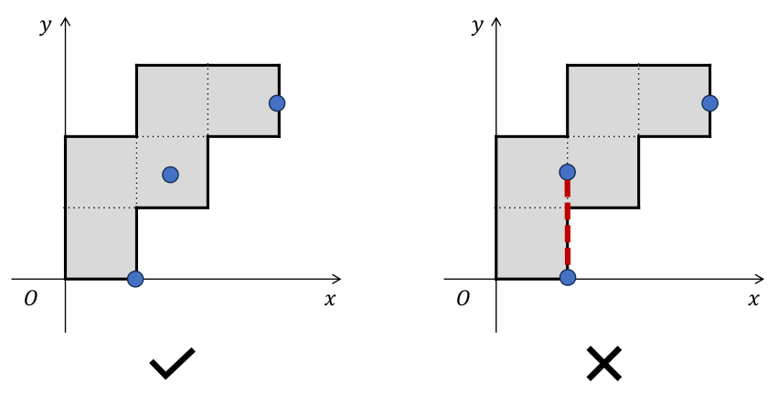

> QOJ 将此版本标注为 AI 翻译，可能存在不准确之处；有疑问时请核对原文。

## 题目描述

时间限制：2.0 秒；内存限制：1024 MB。

一座“阶梯”博物馆被建造用于展览抽象艺术品。为了描述博物馆的形状——即阶梯，我们将地面表示为一个具有无限多个单位正方形单元格的平面，其边缘与 $x$ 轴和 $y$ 轴对齐：对于每一对整数 $(x, y)$，都有一个单元格 $(x, y)$，其左下角坐标为 $(x - 1, y - 1)$，右上角坐标为 $(x, y)$。给定两个序列 $l_1, l_2, \dots, l_n$ 和 $r_1, r_2, \dots, r_n$，所有满足 $1 \le x \le n$ 且 $l_x \le y \le r_x$ 的单元格 $(x, y)$ 构成了博物馆的内部。



前两个样例中的阶梯博物馆。

一群抽象派艺术家将进入博物馆，每位艺术家都会在博物馆的内部或边界上找到一个固定的位置。然而，他们都不希望在欣赏艺术品时看到其他艺术家，因为理解抽象艺术本身就已经足够困难，而看到他人会造成干扰。在这里，两位艺术家可以互相看到，当且仅当连接他们的线段上的每一个点都完全位于博物馆的内部或边界上。



左侧的方案展示了第二个样例的一种可能位置安排。右侧的方案是无效的，因为两位艺术家可以互相看到。

作为博物馆的经理，你有责任确保艺术家们能够享受他们的参观过程而不受彼此干扰。你需要确定在博物馆中，使得没有任何两位艺术家可以互相看到的前提下，能够容纳的艺术家的最大数量。

## 输入格式

输入包含多个测试用例。第一行包含一个整数 $T$ ($1 \le T \le 10^5$)，表示测试用例的数量。对于每个测试用例：

-   第一行包含一个整数 $n$ ($1 \le n \le 5 \times 10^5$)。
-   接下来 $n$ 行，第 $i$ 行包含两个整数 $l_i$ 和 $r_i$ ($1 \le l_i \le r_i \le 10^9$)。对于每个 $i = 1, 2, \dots, n - 1$，满足 $l_i \le l_{i+1} \le r_i \le r_{i+1}$，这确保了博物馆是一个连通的阶梯。

保证所有测试用例的 $n$ 之和不超过 $5 \times 10^5$。

## 输出格式

对于每个测试用例，输出一行，包含一个整数，表示在博物馆中没有任何两位艺术家可以互相看到的前提下，艺术家的最大数量。

## 样例

### 样例输入 1

```text
4
3
1 2
1 3
1 3
3
1 2
2 3
3 3
3
1 1
1 3
3 3
4
1 2
2 3
3 4
4 5
```

### 样例输出 1

```text
2
3
3
4
```
