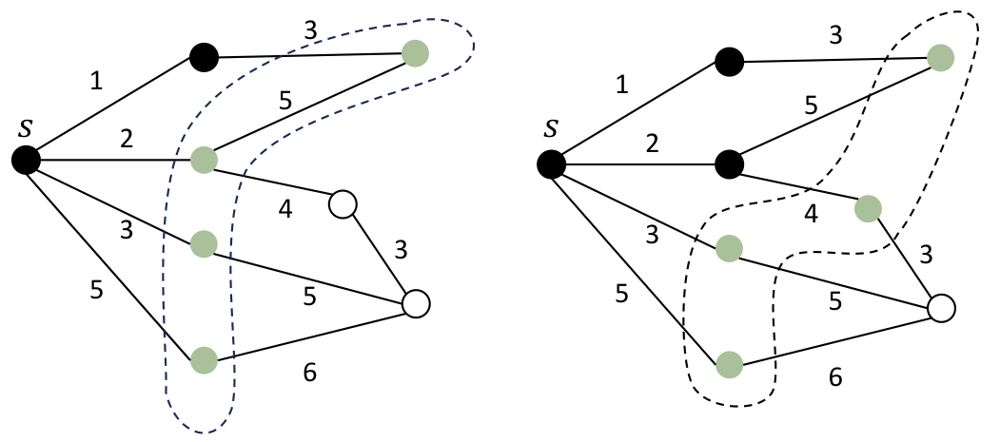
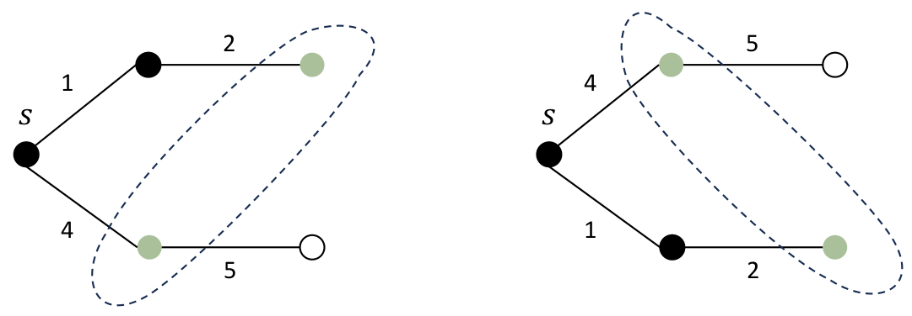

> QOJ 将此版本标注为 AI 翻译，可能存在不准确之处；有疑问时请核对原文。

## 题目描述

时间限制：4.0 秒；内存限制：1024 MB。

最近，FOCS 上的一篇论文《Universal Optimality of Dijkstra via Beyond-Worst-Case Heaps》引起了 Fuyu 的注意。该论文讨论了经典的单源最短路径算法如何通过具有工作集性质（working set property）的堆，在各类图上达到最优性。为了描述这种最优性，文中提出了“探索边界”（exploration boundary）的概念：即在 Dijkstra 算法运行过程中的某个时刻暂停，此时的探索边界就是图上的探索前沿，也就是那些已经被更新但距离尚未确定的顶点。



探索边界的一个示例，右侧边界是在确定了距离源点 $s$ 为 2 的顶点并更新其邻居后，基于左侧边界得到的。

为了更正式地定义它，考虑以下 Dijkstra 算法的描述。如果一个非空顶点集合可以在算法运行到第 6 行时通过提取 $Q$ 中的顶点得到，则称其为探索边界。

算法 1：Dijkstra 算法  
输入：图 $G = (V, E)$，权重 $w$，源点 $s \in V$  
输出：从 $s$ 出发的距离 $D$  
1 $S \leftarrow \{\}$ // 已探索顶点集，初始为空。  
2 $Q \leftarrow \{\}$ // 存储 $(distance, vertex)$ 对的优先队列，按距离排序。初始为空。  
3 $P \leftarrow [\emptyset, \dots, \emptyset]$ // 每个顶点 $v$ 在 $Q$ 中的指针，若 $v$ 尚未插入则为 $\emptyset$。  
4 $D \leftarrow [+\infty, \dots, +\infty]$ // 每个顶点当前从 $s$ 出发的最短距离。  
5 $P[s] \leftarrow Q.Insert((0, s)), D[s] \leftarrow 0$  
6 while $|Q| \neq \emptyset$ do  
7 $(d_u, u) \leftarrow Q.DeleteMin()$  
8 $S \leftarrow S \cup \{u\}$  
9 forall $(u, v) \in E$ where $v \notin S$ do  
10 if $P[v] = \emptyset$ then  
11 $P[v] \leftarrow Q.Insert((+\infty, v))$ // 先插入一个虚拟值。  
12 $D[v] \leftarrow \min(D[v], d_u + w(u, v))$ // 使用 $d_u$ 更新 $v$ 的当前最短距离。  
13 $Q.DecreaseKey(P[v], (D[v], v))$ // 为简单起见，即使 $D[v]$ 未改变也调用此函数。  
14 return $D$

对于无向图 $G$，如果我们分配不同的正权重 $w$，可以得到许多不同的探索边界集合。



两个探索边界的示例，它们可以通过不同的权重获得，但不能同时出现在 Dijkstra 算法的单次运行中。

给定一个无向图 $G$ 和一些期望的探索边界，设源点 $s = 1$，你的任务是构造每条边的权重（如果可能的话），使得：

-   每条边都有一个不超过 $10^9$ 的正整数权重。
-   没有两个顶点到 1 的距离相同，从而使得探索边界在 Dijkstra 算法执行过程中可以被唯一确定。
-   所有期望的探索边界都出现在从 1 开始的 Dijkstra 算法运行过程中。

## 输入格式

输入包含多组测试数据。第一行包含一个整数 $T$ ($1 \le T \le 10^5$)，表示测试数据组数。对于每组测试数据：

-   第一行包含两个整数 $n$ 和 $m$ ($2 \le n \le 2 \times 10^5, 1 \le m \le 2 \times 10^5$)，分别表示顶点数和边数。
-   接下来 $m$ 行，每行包含两个整数 $u$ 和 $v$ ($1 \le u, v \le n$)，描述一条连接顶点 $u$ 和 $v$ 的无向边。
-   接下来一行包含一个整数 $k$ ($1 \le k \le 2 \times 10^5$)，表示期望的探索边界数量。
-   接下来 $k$ 行，每行描述一个边界：首先是一个整数 $b_i$ ($1 \le b_i \le n$)，表示第 $i$ 个边界中的顶点数量，随后是 $b_i$ 个整数，表示边界中的顶点。保证 $b_i$ 个顶点两两不同。

保证输入图是连通的，没有自环和重边，且同一组测试数据中的两个边界不会重合。所有测试数据的 $n$ 之和、$m$ 之和以及 $b_i$ 之和均不超过 $10^6$。

## 输出格式

对于每组测试数据：

-   如果可以构造出这样的权重分配，则输出一行 `Yes`。并在下一行输出 $m$ 个整数，表示输入中各边对应的权重。每个权重必须是 $[1, 10^9]$ 范围内的正整数。
-   否则，输出一行 `No`。

## 样例

### 输入 1

```text
2
8 10
1 2
1 3
1 4
1 5
2 6
3 6
3 7
4 8
5 8
7 8
2
4 3 4 5 6
4 4 5 6 7
5 4
1 2
1 3
2 4
2 5
2
2 3 4
2 2 5
```

### 输出 1

```text
Yes
1 2 3 5 3 5 4 5 6 3
No
```

---

来源：[QOJ 中文题面](https://qoj.ac/problem/9985/statement/zh_cn)。保留 QOJ 提供的中文内容，仅转换为 Markdown 排版；原题及图示版权归原作者所有。 QOJ 中文页中失效或错配的图片已按原有顺序补为[官方英文题面](https://qoj.ac/download.php?type=attachments&id=1894&r=0)中的对应图示。
