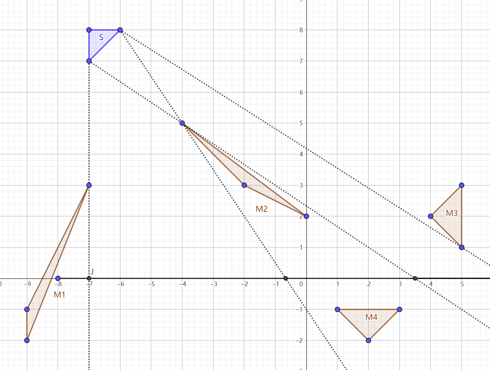
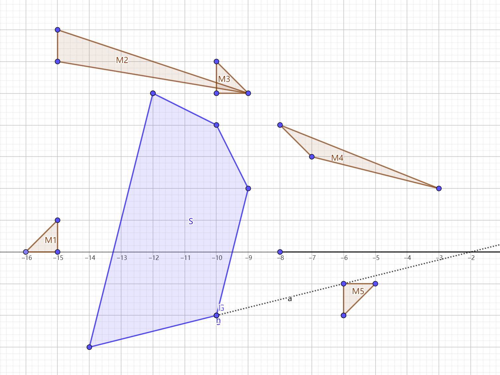

> QOJ 将此版本标注为 AI 翻译，可能存在不准确之处；有疑问时请核对原文。

## 题目描述

时间限制：4.0 秒；内存限制：1024 MB。

BaoBao 买了一台望远镜来观测夜空中的星星。这颗星星被表示为一个凸多边形 $S$。然而，有 $n$ 个凸多边形月亮 $M_i$ 可能会阻挡他的视线。BaoBao 可以将他的望远镜放置在 $x$ 轴上点 $(l, 0)$ 和 $(r, 0)$ 之间的任意位置，但他不能将其放置在 $(l, 0)$ 或 $(r, 0)$ 上。

你的任务是帮助 BaoBao 计算他在 $x$ 轴上可以放置望远镜的线段总长度，使得他能无遮挡地观测到星星 $S$，并判断他是否能找到这样的位置。无遮挡的视线意味着从 $x$ 轴上所选点到 $S$ 内部或边界上任意一点的连线段，都不会与任何月亮 $M_i$ 发生实质性相交。连线段可以接触月亮的边界，但不能穿过它们。

## 输入格式

输入包含多组测试数据。第一行包含一个整数 $T$ ($1 \le T \le 2.5 \times 10^4$)，表示测试数据的组数。对于每组测试数据：

第一行包含三个整数 $n, l, r$ ($1 \le n \le 10^4, -10^9 \le l < r \le 10^9$)，分别表示月亮的数量和望远镜放置的范围。

第二行描述星星 $S$，以一个整数 $k_0$ ($3 \le k_0 \le 10^5$) 开头，表示 $S$ 的顶点数，随后是 $2 \times k_0$ 个整数 $x_{0,1}, y_{0,1}, x_{0,2}, y_{0,2}, \dots, x_{0,k_0}, y_{0,k_0}$ ($-10^9 \le x_{0,j}, y_{0,j} \le 10^9$)，其中 $(x_{0,j}, y_{0,j})$ 是 $S$ 的第 $j$ 个顶点的坐标，按逆时针顺序给出。

接下来的 $n$ 行，第 $i$ 行描述月亮 $M_i$。每行以一个整数 $k_i$ ($3 \le k_i \le 10^5$) 开头，表示 $M_i$ 的顶点数，随后是 $2 \times k_i$ 个整数 $x_{i,1}, y_{i,1}, x_{i,2}, y_{i,2}, \dots, x_{i,k_i}, y_{i,k_i}$ ($-10^9 \le x_{i,j}, y_{i,j} \le 10^9$)，其中 $(x_{i,j}, y_{i,j})$ 是 $M_i$ 的第 $j$ 个顶点的坐标，按逆时针顺序给出。

保证 $S$ 和 $M_i$ 均为凸多边形。星星 $S$、月亮 $M_i$ 以及从 $(l, 0)$ 到 $(r, 0)$ 的线段互不接触或相交。然而，不同的月亮 $M_i$ 之间可以相交。同一多边形的任意三个连续顶点不共线。

保证所有测试数据中 $\sum_{i=0}^n k_i$ 的总和不超过 $10^6$。同时保证所有测试数据中多边形的总数（即 $\sum (n+1)$）不超过 $5 \times 10^4$。

## 输出格式

对于每组测试数据，输出一行，包含在 $(l, 0)$ 和 $(r, 0)$ 之间，BaoBao 可以放置望远镜以无遮挡观测 $S$ 的有效线段总长度。如果 $(l, 0)$ 和 $(r, 0)$ 之间不存在有效点，则输出 $-1$。

如果你的答案与标准答案的相对误差或绝对误差不超过 $10^{-9}$，则视为正确。

## 样例

### 样例输入 1

```text
2
4 -8 8
3 -7 7 -6 8 -7 8
3 -9 -2 -7 3 -9 -1
3 -2 3 0 2 -4 5
3 5 1 5 3 4 2
3 1 -1 2 -2 3 -1
5 -8 8
5 -14 -3 -10 -2 -9 2 -10 4 -12 5
3 -16 0 -15 0 -15 1
3 -15 6 -9 5 -15 7
3 -10 5 -9 5 -10 6
3 -7 3 -3 2 -8 4
3 -6 -1 -6 -2 -5 -1
```

### 样例输出 1

```text
9.404761904761905
6.000000000000000
```

### 样例输入 2

```text
3
1 -4 4
3 -2 6 0 5 2 6
3 -3 1 3 1 0 4
3 -2 2
3 -2 4 2 4 0 6
3 -2 2 -1 2 -2 3
3 1 2 2 2 2 3
3 -2 -1 0 -3 2 -1
1 1 2
3 -8 0 -7 0 -8 1
3 -5 0 -4 -1 -4 0
```

### 样例输出 2

```text
-1.000000000000000
0.000000000000000
1.000000000000000
```

### 样例输入 3

```text
1
1 -744567334 955216804
5
-781518205 -852078097
-781516900 -852078384
-781516392 -852076569
-781518329 -852076047
-781519925 -852077600
5
-393011614 -131855702
-393010699 -131856607
-393008846 -131856475
-393009388 -131854587
-393010201 -131854694
```

### 样例输出 3

```text
1699779738.691979192313738
```

## 说明

对于第一个样例，第一组测试数据如图所示；望远镜可以放置在 $(-7, 0)$ 和 $(-\frac{2}{3}, 0)$ 之间，或者 $(\frac{7}{2}, 0)$ 和 $(\frac{46}{7}, 0)$ 之间。

第二组测试数据如图所示；望远镜可以放置在 $(-8, 0)$ 和 $(-2, 0)$ 之间。

请注意，第三个样例中的输入格式仅用于演示目的，因为我们无法在不超出纸张宽度的情况下将所有坐标打印在同一行。请参考其他样例以获取更准确的输入格式。





---

来源：[QOJ 中文题面](https://qoj.ac/problem/9728/statement/zh_cn)。保留 QOJ 提供的中文内容，仅转换为 Markdown 排版；原题及图示版权归原作者所有。
