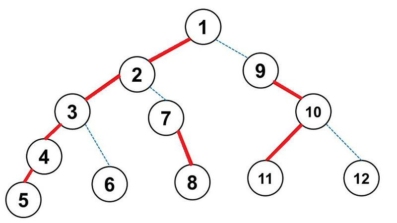

## 题目描述

时间限制：1.0 秒。

重链剖分（Heavy-light Decomposition，简称 HLD）是一种应用于树的有效技术，用于高效查询顶点链。在开始之前，我们先回顾一下 HLD 的定义。

给定一棵有 $n$ 个顶点的有根树，顶点编号从 $1$ 到 $n$。你需要将每个非根顶点分类为重顶点或轻顶点。每个非叶子节点恰好有一个子节点被分类为重节点，其余子节点为轻节点。

对于任意非根顶点 $v$，设 $u$ 为其父节点。仅当 $v$ 的子树大小在 $u$ 的所有子节点中最大时，顶点 $v$ 才能被分类为重节点。更正式地说，记以顶点 $v$ 为根的子树大小为 $s_v$，并令 $\text{ch}(u)$ 表示 $u$ 的子节点集合。那么，仅当对于所有 $w \in \text{ch}(u)$ 都有 $s_v \geq s_w$ 时，$v$ 才能是重节点。注意，$u$ 的子节点中可能存在多个满足此约束的节点；在这种情况下，你应该选择其中一个作为重节点，其余的作为轻节点。

此后，树的所有顶点可以分解为若干个互不重叠的重链，其中每个顶点恰好属于一条重链。重链是一个满足以下所有约束的顶点序列 $x_1, x_2, \dots, x_k$：

-   $x_1$ 是根节点或轻节点。
-   对于所有 $2 \leq i \leq k$，$x_i$ 是 $x_{i-1}$ 的子节点且是重节点。
-   $x_k$ 是叶子节点。



一个 HLD 示例。重链用实线红边标记。

例如，上图展示了一棵具有 12 个顶点的树的有效 HLD，其中重链为 $[1, 2, 3, 4, 5]$、$[9, 10, 11]$、$[7, 8]$、$[6]$ 和 $[12]$。

Pig100Ton 是 Pigeland 的一名资深竞赛选手。他想知道是否可以从 HLD 后的重链中恢复出原始树。具体来说，他会给你原始树的顶点数 $n$ 和 $k$ 条重链。第 $i$ 条链由两个整数 $l_i$ 和 $r_i$ 描述，表示重链为 $l_i, l_i + 1, \dots, r_i$。

你的任务是构造一棵满足以下约束的树，或者告诉 Pig100Ton 这是不可能的：

-   它是一棵包含 $n$ 个顶点（编号从 $1$ 到 $n$）的有根树。
-   Pig100Ton 提供的 $k$ 条链应构成该树的有效 HLD。有效的 HLD 指的是一种将每个非根顶点分类为轻节点或重节点，并将树分解为若干互不重叠的重链的有效方式。

## 输入格式

输入包含多组测试数据。第一行包含一个整数 $T$ ($1 \leq T \leq 10^5$)，表示测试数据组数。对于每组测试数据：

第一行包含两个整数 $n$ 和 $k$ ($1 \leq n \leq 10^5, 1 \leq k \leq n$)，表示树的顶点数和 HLD 后的重链数。

接下来的 $k$ 行中，第 $i$ 行包含两个整数 $l_i$ 和 $r_i$ ($1 \leq l_i \leq r_i \leq n$)，表示第 $i$ 条重链为 $l_i, l_i + 1, \dots, r_i$。

保证每个顶点恰好属于给定的某一条重链。同时保证所有测试数据的 $n$ 之和不超过 $2 \times 10^5$。

## 输出格式

对于每组测试数据：

如果可以构造出这样一棵树，输出一行包含 $n$ 个整数 $p_1, p_2, \dots, p_n$，以空格分隔，其中 $p_i$ 是顶点 $i$ 的父节点。$p_i = 0$ 表示顶点 $i$ 是根节点。如果存在多个有效解，你可以输出其中任意一个。

如果无法构造出这样一棵树，则输出一行 `IMPOSSIBLE`。

## 样例

### 输入 1

```text
3
12 5
1 5
9 11
7 8
6 6
12 12
4 3
1 1
4 4
2 3
2 2
1 1
2 2
```

### 输出 1

```text
0 1 2 3 4 3 2 7 1 9 10 10
2 0 2 2
IMPOSSIBLE
```

## 说明

对于第一组测试数据，样例输出即为题目描述中的树。
