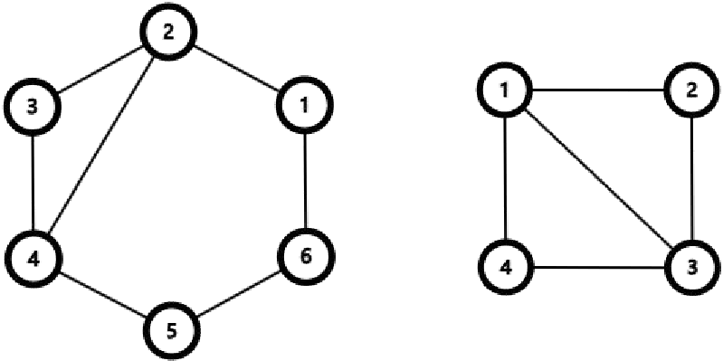

## 题目描述

时间限制：1.0 秒。

这是一个交互式问题。

Grammy 拥有一个包含 $n$ ($4 \le n \le 10^9$) 个顶点的无向循环图，顶点编号从 $1$ 到 $n$。无向循环图是指一个包含 $n$ 个顶点和 $n$ 条无向边的图，这些边构成一个环。具体来说，对于每个 $1 \le i \le n$，顶点 $i$ 和顶点 $((i \pmod n) + 1)$ 之间存在一条双向边。

Grammy 认为这个图太无聊了，于是她秘密地选择了一对不相邻的顶点，并在它们之间连接了一条无向边（称为弦），使得该图现在包含 $n$ 个顶点和 $(n + 1)$ 条边。

你的任务是通过不超过 $40$ 次询问来猜出这条弦的位置。每次询问包含两个顶点 $x$ 和 $y$，Grammy 会告诉你这两个顶点之间最短路径上的边数。

注意，交互器是非自适应的，这意味着弦的位置是预先确定的。

## 输入格式

输入包含多个测试用例。第一行包含一个整数 $T$ ($1 \le T \le 10^3$)，表示测试用例的数量。每个测试用例：

第一行包含一个整数 $n$ ($4 \le n \le 10^9$)，表示顶点的数量。

## 交互

进行询问时，输出一行。首先输出 `?`，后跟一个空格，然后输出两个由空格分隔的顶点 $x$ 和 $y$ ($1 \le x, y \le n$)。刷新输出后，你的程序应读取一个整数，表示这两个顶点之间最短路径上的边数。

要猜测弦的位置，输出一行。首先输出 `!`，后跟一个空格，然后输出两个由空格分隔的顶点 $u$ 和 $v$ ($1 \le u, v \le n$)，表示弦连接了顶点 $u$ 和 $v$。刷新输出后，你的程序应读取一个整数 $r$ ($r \in \{1, -1\}$)，表示猜测的正确性。如果 $r = 1$，则说明你的猜测正确，程序应继续处理下一个测试用例，或者如果没有更多测试用例，则立即退出。如果 $r = -1$，则说明你的猜测错误，程序应立即退出以接收 Wrong Answer 判决。注意，你的猜测不计入询问次数。

刷新输出可以使用：

-   在 C 和 C++ 中使用 `fflush(stdout)` (如果使用 `printf`) 或 `cout.flush()` (如果使用 `cout`)。
-   在 Java 中使用 `System.out.flush()`。
-   在 Python 中使用 `stdout.flush()`。

## 样例

### 样例输入 1

```text
2
6
2
1
1
4
2
1
```

### 样例输出 1

```text
? 1 5
? 2 4
! 4 2
? 2 4
! 1 3
```

## 说明

样例测试用例中的图示如下：


