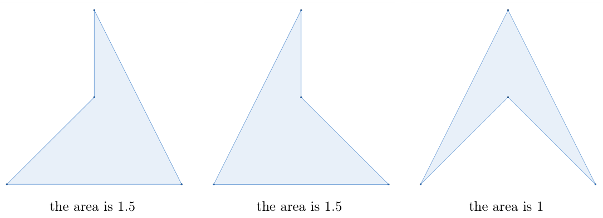

> QOJ 将此版本标注为 AI 翻译，可能存在不准确之处；有疑问时请核对原文。

## 题目描述

时间限制：3.0 秒；内存限制：1024 MB。

给定平面上的 $n$ 个点，第 $i$ 个点的坐标为 $(x_i, y_i)$。

凹包（Concave Hull）是一个简单多边形（即没有自交），其顶点集是给定 $n$ 个点的一个非空子集，且所有 $n$ 个点均位于该多边形内部或边界上。该多边形恰好有一个内角大于 $\pi$，其余所有内角均小于 $\pi$。

计算所有凹包面积之和的两倍。由于答案可能很大，请输出其对 $10^9 + 7$ 取模的结果。

## 输入格式

第一行包含一个整数 $n$ ($3 \le n \le 2 \cdot 10^3$)，表示点的数量。

接下来 $n$ 行，第 $i$ 行包含两个整数 $x_i, y_i$ ($0 \le x_i, y_i \le 10^9$)，表示第 $i$ 个点的坐标。

保证 $n$ 个点互不相同，且任意三点不共线。

## 输出格式

输出一行一个整数，表示所有凹包面积之和的两倍对 $10^9 + 7$ 取模的结果。

## 样例

### 样例输入 1

```text
4
0 0
2 0
1 2
1 1
```

### 样例输出 1

```text
8
```

### 样例输入 2

```text
15
3442 3341
3136 3120
3228 3113
3143 2981
3050 3052
2970 2973
2964 3011
2921 2927
2844 2715
2655 2661
2666 2637
2755 2731
2657 2684
2662 2629
2542 2508
```

### 样例输出 2

```text
23993862
```

## 说明

对于第一个样例，共有三个凹包。



面积为 1.5，面积为 1.5，面积为 1

因此总面积为 4，答案为 $4 \times 2 = 8$。

---

来源：[QOJ 中文题面](https://qoj.ac/problem/9919/statement/zh_cn)。保留 QOJ 提供的中文内容，仅转换为 Markdown 排版；原题及图示版权归原作者所有。 QOJ 中文页中失效或错配的图片已按原有顺序补为[官方英文题面](https://qoj.ac/download.php?type=attachments&id=1885&r=0)中的对应图示。
