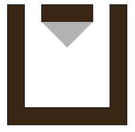

## 题目描述

时间限制：5.0 秒；内存限制：1024 MB。

看哪，冒险者！不经审视，切勿踏入深渊。

传说迷宫中总会有牛头怪。但什么是迷宫呢？发生了无数令人悲痛的事件，伟大的战士 Alan 决定亲自处理这些问题。

作为镇上最负盛名的战士之一，有一天，他根据以往的经验提出了一些猜想。当你只能待在结构外部时，眼睛看不到的区域可能就是危险的真正来源。他在酒吧召集了朋友们讨论这个新想法。之后，他们得出了如何科学地测量这一属性的结论。

在脑海中构思一个结构的二维地图。该结构由多个墙壁组成，可以用多边形来描述。这些墙壁阻挡了移动和视线。也就是说，你既不能穿过墙壁，也不能看穿墙壁。墙壁上没有洞（Alan 是战士，不是法师），因此，如果一个点不在墙内，它就是从外部可到达的。讨论的主要见解是，如果某个可到达的点在结构外部可见，那么对于任何距离，它都应该在某个角度上，以该距离在某个地方可见。用数学术语来说，对于任何半径 $r$，我们可以在以该点为圆心的圆上选取一个点，使得该点与目标点之间的线段不与任何墙壁相交。任何在外部不可见的点都被称为隐藏点，他们对可到达但隐藏的区域感兴趣。



图 A.1：样例输入 1 的迷宫地图。墙壁用棕色阴影表示，可到达但隐藏的区域用灰色阴影表示。

那天晚上晚些时候，人们困惑地盯着地图，毫无进展。除了去实地考察，他们都没有好的方法来测量这个面积。当然，这太冒险且不切实际，因为 Alan 无法同时保护所有人。也许你能帮忙？帮他们找出地图上隐藏的可到达区域，以验证他们的猜想。

## 输入格式

第一行包含一个数字 $n$ ($1 \le n \le 30$)，即描述结构中墙壁的多边形数量。接下来的 $n$ 行，每行包含若干整数。每行的第一个数字是第 $i$ 个多边形的顶点数 $k_i$ ($3 \le k_i \le 90$)。紧随其后的是 $2k_i$ 个整数 $x_1, y_1, x_2, y_2, \dots, x_{k_i}, y_{k_i}$ ($-10^4 \le x_j, y_j \le 10^4$)，它们是多边形顶点的坐标，按顺时针或逆时针顺序排列。输入中不会有重复的顶点。给定的多边形是简单的，即它们没有孔且从不自交。两个多边形在任何点上都不会重叠。顶点总数不超过 90。

## 输出格式

输出一个浮点数，表示地图中可到达的隐藏区域面积。你的答案应具有不超过 $10^{-6}$ 的绝对或相对误差。

## 样例

### 样例输入 1

```text
2
8 0 0 7 0 7 7 6 7 6 1 1 1 1 7 0 7
4 2 7 5 7 5 6 2 6
```

### 样例输出 1

```text
2.25
```

### 样例输入 2

```text
2
4 2 4 5 8 9 4 5 7
4 4 5 5 1 6 5 5 4
```

### 样例输出 2

```text
1.4
```
