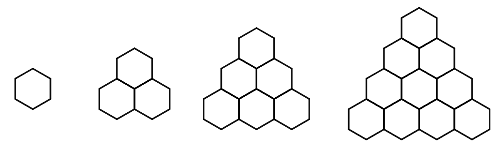
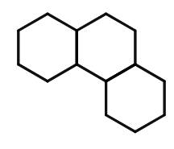
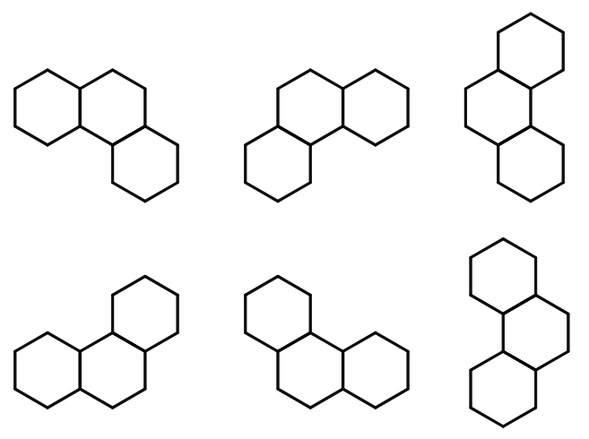

> QOJ 将此版本标注为 AI 翻译，可能存在不准确之处；有疑问时请核对原文。

## 题目描述

时间限制：1.0 秒；内存限制：1024 MB。

Kotoha 喜欢解谜。今年，她的朋友 Saki 和 Yui 送给她一个特殊的拼图作为生日礼物：一个六边形拼图和许多彩色的 V 形拼块。拼图包含 $n$ 行正六边形，其中第 $i$ 行恰好包含 $i$ 个正六边形。对于每个 $i > 1$，第 $i$ 行的第 $j$ 个正六边形与上一行中第 $j$ 个和第 $j-1$ 个正六边形共边（如果它们存在的话）。以下分别是 $n = 1, 2, 3, 4$ 时的拼图示例：



一个 V 形拼块占据 3 个六边形，如下图所示。每个拼块的颜色可以是 26 种颜色之一，用 `ABC...XYZ` 表示：



拼块可以旋转 60 度的倍数。更具体地说，V 形拼块有 6 种可能的旋转方式，如下图所示：



现在，Kotoha 想要在满足以下条件的前提下，最大化她使用的 V 形拼块数量：

-   她使用的每个 V 形拼块都必须放置在拼图内部，且恰好占据 3 个六边形。
-   没有两个 V 形拼块占据同一个六边形。
-   没有两个相邻的 V 形拼块颜色相同。如果两个拼块至少共享一条公共边，则认为它们是相邻的。

你能帮她找到最大 V 形拼块数量以及一种放置方案吗？

## 输入格式

输入仅包含一行，包含一个整数 $n$ ($1 \le n \le 1024$)，表示拼图的大小。

## 输出格式

输出 $n$ 行。第 $i$ 行包含 $n + i - 1$ 个字符。设 $s_{i,j}$ 为第 $i$ 行的第 $j$ 个字符。你的输出必须满足以下格式：

-   如果 $j \le n - i$，$s_{i,j}$ 为一个空格（ASCII 码 32）。
-   如果 $j - (n - i)$ 是偶数，$s_{i,j}$ 为一个空格。
-   如果第 $i$ 行的第 $\frac{j-(n-i)+1}{2}$ 个六边形没有被任何 V 形拼块覆盖，$s_{i,j}$ 为一个点（ASCII 码 46）。
-   否则，$s_{i,j}$ 用于表示覆盖第 $i$ 行第 $\frac{j-(n-i)+1}{2}$ 个六边形的 V 形拼块的颜色，该颜色将是 26 个大写英文字母之一。

如果满足以下所有条件，你的输出将被视为正确：

-   满足上述所有格式要求。
-   你放置的所有拼块都是 V 形的。
-   没有两个相邻的 V 形拼块颜色相同。
-   你放置的拼块数量达到最大。

请不要在每行末尾输出多余的空格，否则你的解可能被视为错误。

## 样例

### 样例输入 1

```text
2
```

### 样例输出 1

```text
.
. .
```

### 样例输入 2

```text
3
```

### 样例输出 2

```text
W
W .
. W .
```

### 样例输入 3

```text
4
```

### 样例输出 3

```text
.
. R
. B R
B B R .
```
