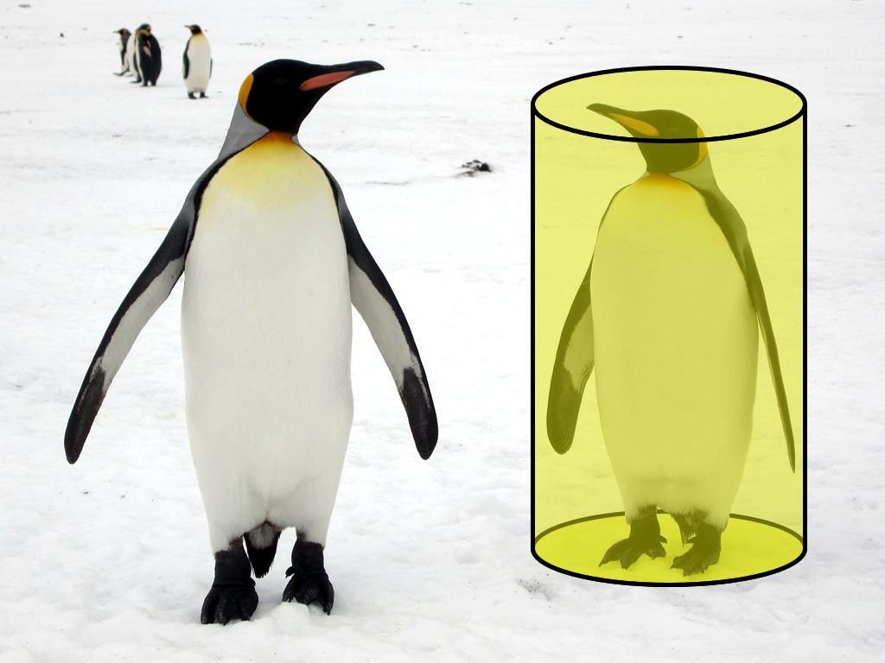

> QOJ 将此版本标注为 AI 翻译，可能存在不准确之处；有疑问时请核对原文。

## 题目描述

时间限制：1.0 秒；内存限制：256 MB。

企鹅是几乎只生活在南半球的不会飞的海鸟。这些游泳健将一直是动物园中最受欢迎的物种之一，但不幸的是，这些可爱的生物正受到气候变化的威胁。这就是国际企鹅保护中心（ICPC）发起一个项目来研究如何拯救它们的原因。他们投放了最先进的自动驾驶车辆——许多带有伪装的漫游车在现场四处走动，收集研究图像。通过结合来自不同视角的多个图像，可以在 3D 模型下以更系统的方式研究这些鸟类。然而，缺点是这种计算显然无法通过人力完成，这就是机器学习的用武之地。不幸的是，它没有成功。机器标记并创建了完全无意义的内容。

模型可能出了问题。尽管如此，ICPC 仍需要对其训练方法进行彻底的改革。人们提出了许多建议，其中大多数都很容易实现。然而，他们发现了一个特别具有挑战性的问题：他们想惩罚模型标记那些不像企鹅的形状，但究竟是什么让一个形状看起来像企鹅呢？

事实证明，物理学家几年前就已经知道了：那是一个圆柱体！

检查是否存在一个圆柱体，其表面覆盖了算法标记的所有点，这有多难？事实是，几个月来一直没有有效的结果。因此，他们降低了短期目标，决定只输入直立企鹅的图片。也就是说，圆柱体被限制为一个直圆柱体（其圆柱面垂直于圆形底面的圆柱体），且其底面位于 $x-y$ 平面上。当然，企鹅既不是虚构的，也不是无限的。体积为零或无限的圆柱体应被排除。作为著名的计算机科学家和几何大师，你能解决这个任务吗？

## 输入格式

第一行包含一个数字 $n$ ($1 \le n \le 10^5$)，即模型标记的点数。 接下来的 $n$ 行，每行包含三个整数 $x, y$ 和 $z$ ($-10^9 \le x, y \le 10^9, 0 \le z \le 10^9$)，表示三维空间中坐标为 $(x, y, z)$ 的一个点。输入中不会有重复的点。

## 输出格式

如果存在满足所有约束的圆柱体，则在第一行输出 “probably”。否则，输出 “not a penguin”。

## 样例

### 输入 1

```text
5
0 0 0
3 4 1
-3 -4 2
-3 4 3
3 -4 4
```

### 输出 1

```text
probably
```

### 输入 2

```text
4
0 6 2
3 4 1
-3 -4 1
-3 4 1
```

### 输出 2

```text
not a penguin
```

### 输入 3

```text
2
0 0 0
1 1 0
```

### 输出 3

```text
probably
```



Figure 1. A penguin inside a cylinder

---

来源：[QOJ 中文题面](https://qoj.ac/problem/9049/statement/zh_cn)。保留 QOJ 提供的中文内容，仅转换为 Markdown 排版；原题及图示版权归原作者所有。
