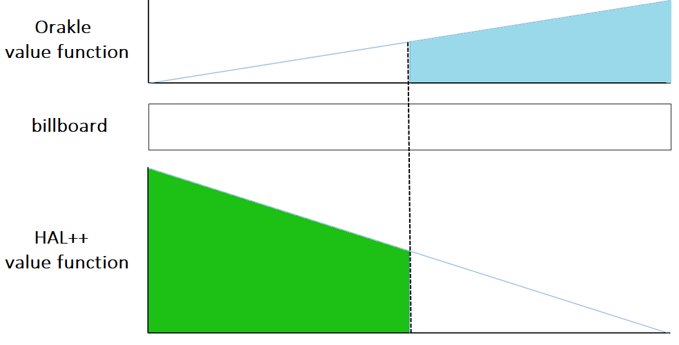

## 题目描述

时间限制：6 秒；内存限制：2048 MB。

每年，ICPC（国际大学生程序设计竞赛）都有许多赞助商。由于赞助商满意意味着竞赛顺利，我们计划在竞赛区域的一侧增加一个长广告牌，以便我们可爱的赞助商可以在上面放置他们的广告。

总共有 $n$ 个优秀的赞助商，为了公平起见，我们希望给他们每人 $1/n$ 的广告牌总面积。然而，情况比较复杂，因为每个赞助商对广告牌不同部分的评价可能不同。例如，一些赞助商希望把广告放在竞赛区域的入口附近，这可能是所有参赛者进入时必然会看到的角落。另一方面，一些赞助商可能只想把广告放在中间，这样更有可能在直播中播出。（别问我们如果入口在中间会发生什么！这只是个例子。）

在与我们所有令人愉快的赞助商交谈后，ICPC 工作人员发现每个赞助商的偏好值可以建模为一个连续的分段线性函数，其中每个价值函数的定义域都是广告牌的长度。有了这些信息，ICPC 工作人员希望将广告牌分成 $n$ 个部分，并分给我们的 $n$ 个赞助商，使得每个赞助商从他们的角度来看，至少能获得广告牌总价值的 $1/n$。也就是说，每个赞助商获得的部分下方的价值函数面积必须至少是他们自身价值函数总面积的 $1/n$。

图 A.1 展示了一个简单的例子。广告牌长度为 10，有两个赞助商，Orakle Software 和 Hal++，他们两者的价值函数都只有一个片段。Orakle 的价值函数表明，随着从左向右移动，公司越来越倾向于广告牌的后半部分，而 Hal++ 的价值函数则相反。每个函数下方的面积是从每个赞助商的角度来看广告牌的总价值。图中显示的蓝色和绿色区域都大于各自总面积的一半，因此从中间切割广告牌（虚线）是一个有效的解决方案，从而得到图 A.2 所示的广告牌。请注意，还有许多其他分割广告牌的方法也同样有效（例如，如果将广告牌部分分给正确的赞助商，在 4 或 6 处切割也是有效的解决方案）。



图 A.1：样例输入 1

## 输入格式

第一行包含两个整数：$n$ ($1 \le n \le 5\,000$)，即 ICPC 的赞助商数量（编号为 1 到 $n$），以及 $l$ ($1 \le l \le 10^6$)，即广告牌的长度。

接下来的 $n$ 行，每行以一个整数 $m$ ($2 \le m \le 5\,000$) 开头，表示指定该赞助商价值函数的点数。该行的其余部分包含 $m$ 对整数 $(a_1, b_1), \dots, (a_m, b_m)$ ($0 = a_1 < a_2 < \dots < a_m = l, 0 \le b_i \le 100$)，其中每对整数代表分段线性函数的一个端点。所有 $m$ 的总和最多为 $500\,000$，并且保证每个赞助商至少有一个 $b_i$ 为正数。


图 A.2：对应样例输出 1 的最终广告牌

## 输出格式

输出 $n$ 对数字 $(l_i, f_i)$ ($1 \le i \le n$)，表示范围 $[l_{i-1}, l_i]$ 内的广告牌部分分配给赞助商 $f_i$（假设 $l_0 = 0$，$l_0 < l_1 < l_2 < \dots < l_n$，且 $l_n$ 必须等于 $l$）。$f_i$ 的值必须是 $[1, n]$ 范围内的整数，且每个整数恰好出现一次，但 $l_i$ 可以是实数。如果存在多个解，输出其中任意一个。如果没有解，输出 `impossible`。

请注意，你不需要优化任何其他内容，只要每个赞助商获得至少 $1/n$ 的总面积即可。如果绝对误差或相对误差不超过 $10^{-8}$，则每个赞助商分配到的面积可以低于其总面积的 $1/n$。

## 样例

### 样例输入 1

```text
2 10
2 0 0 10 5
2 0 10 10 0
```

### 样例输出 1

```text
5 2
10 1
```

### 样例输入 2

```text
5 100
5 0 0 10 0 20 1 30 0 100 0
5 0 0 10 0 20 1 30 0 100 0
5 0 0 10 0 20 1 30 0 100 0
5 0 0 10 0 20 1 30 0 100 0
5 0 0 10 0 20 1 30 0 100 0
```

### 样例输出 2

```text
16.3245553203 1
18.9442719100 2
21.0557280900 3
23.6754446797 4
100 5
```
