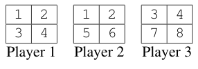

## 题目描述

时间限制：1 秒；内存限制：2048 MB。

Bingo 是一种多人博弈游戏。每位玩家会收到一张写有若干数字的卡片，游戏主持人会以随机顺序喊出这些数字。玩家将听到的数字从自己的卡片上划掉，最先将卡片上所有数字划掉的玩家获胜。这个基础版本的游戏以“节奏缓慢”著称，除了不睡着之外，玩家不需要进行任何特殊操作。

在本题中，我们将分析一种需要快速思考的动态版 Bingo。在我们这个名为“极速 Bingo”（Speed Bingo）的版本中，游戏主持人同样会以随机顺序喊出卡片上的数字。然而，每当一个数字被喊出时，只有第一个示意自己拥有该数字的玩家才能将其从卡片上划掉。如果一名玩家多次拥有同一个数字，每次也只能划掉其中的一个。当多名玩家的卡片上都有同一个数字时，反应最快的玩家在“极速 Bingo”中就占据了优势。但这种优势有多大呢？这就是我们需要你帮忙解决的问题。

形式化地，共有 $n$ 名玩家，每人收到一张包含 $k$ 个数字（不一定互不相同）的卡片。玩家 1 的反应速度快于玩家 2，玩家 2 快于玩家 3，以此类推，玩家 $n$ 的反应最慢。考虑以下对应第一个样例输入的例子，三名玩家每人收到四个数字：



当数字“1”第一次被喊出时，玩家 1（反应更快）将能够将其从卡片上划掉。当“1”第二次被喊出时，玩家 2 将能够将其划掉。因此，平均而言，我们预期玩家 1 的表现会优于玩家 2 和玩家 3，因为后两者需要的一些数字会被玩家 1 先抢走。然而，由于玩家 2 和玩家 3 没有共同的数字，他们的表现是相互独立的，尽管玩家 2 的反应速度快于玩家 3。

假设游戏一直进行到所有玩家都划掉了他们卡片上的所有数字，即直到所有卡片上的 $n \cdot k$ 个数字（包括相应的重复数字）都被读出。假设数字出现的顺序是均匀随机的，请问每位玩家最后完成游戏的概率是多少？

## 输入格式

输入描述了一场“极速 Bingo”游戏。第一行包含两个整数 $n$ 和 $k$，分别表示玩家人数和每张卡片上的数字个数（$1 \le n \le 100$，$1 \le k \le 1000$）。接下来 $n$ 行，每行包含 $k$ 个整数，其中第 $i$ 行给出了第 $i$ 位玩家卡片上的数字。所有数字均在 $1$ 到 $10^9$ 之间（含边界）。

## 输出格式

输出 $n$ 行，每行对应一位玩家。第 $i$ 行应包含第 $i$ 位玩家最后完成游戏的概率。所有数值的绝对误差应不超过 $10^{-6}$。

## 样例

### 样例输入 1

```text
3 4
1 2 3 4
1 2 5 6
3 4 7 8
```

### 样例输出 1

```text
0.000000000
0.500000000
0.500000000
```

### 样例输入 2

```text
4 2
1 2
3 4
10 5
7 8
```

### 样例输出 2

```text
0.250000000
0.250000000
0.250000000
0.250000000
```
