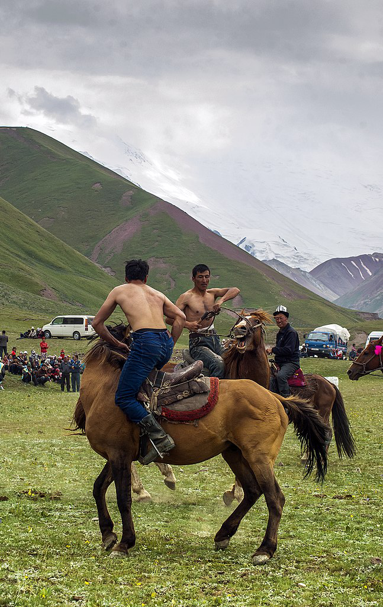

## 题目描述

时间限制：4 秒；内存限制：2048 MB。

游牧运动探索委员会（NGEC）正在筹划一场双人马上摔跤锦标赛，每对骑手共乘一匹马。他们已经宣传了这项试点锦标赛，并且有 $n$ 名热情的骑手报名参加！现在，NGEC 需要将这些骑手两两配对，以使比赛既公平又精彩。

中亚 Audaryspak 联盟（CAAL）维护着一份所有马上摔跤手的名单及其评分。根据以往普通马上摔跤比赛的经验，NGEC 认为，如果一对骑手的评分之和等于一个特定的整数 $s$，那么这对组合是最平衡的。

由于某些模糊的许可原因，CAAL 拒绝公布每位骑手的确切评分。但 NGEC 有一些很好的估计，他们知道任何骑手 $i$ 的真实评分 $r_i$ 位于区间 $[l_i, u_i]$ 内。因此，如果存在评分 $r_i \in [l_i, u_i]$ 和 $r_j \in [l_j, u_j]$ 使得 $r_i + r_j = s$，NGEC 就会考虑将骑手 $i$ 和 $j$ 配对。

NGEC 希望尽可能多地组成互不重叠的骑手对。你需要帮助他们。



吉尔吉斯斯坦的马上摔跤，作者 Theklan，来自维基共享资源，CC BY-SA 4.0

## 输入格式

第一行包含两个整数 $n$ 和 $s$ ($2 \le n \le 2 \cdot 10^5, 1 \le s \le 10^9$)，分别表示骑手人数和期望的评分之和。骑手编号为 $1$ 到 $n$。接下来 $n$ 行，其中第 $i$ 行包含两个整数 $l_i$ 和 $u_i$ ($1 \le l_i \le u_i \le 10^9$)，表示第 $i$ 位骑手的评分范围。

## 输出格式

输出 $k$，即可以组成的最大骑手对数，随后输出 $k$ 行，每行包含一对整数，表示组成该对的骑手编号。如果存在多种配对方式，输出其中任意一种即可。

## 样例

### 输入 1

```text
6 10
6 7
1 4
2 2
3 8
5 7
9 9
```

### 输出 1

```text
2
6 2
3 4
```
