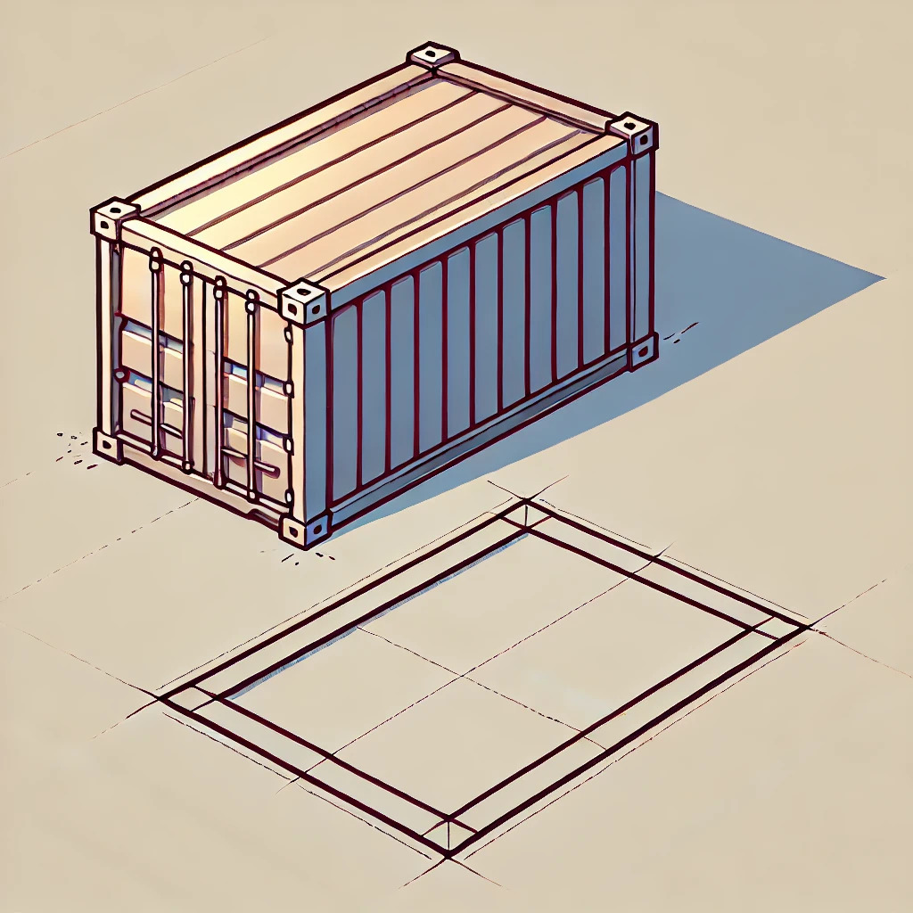

## 题目描述

时间限制：2 秒；内存限制：2048 MB。

一个巨大的长方体集装箱被送到了你的货场。在打开它之前，你需要先将集装箱移动到货场的不同位置。

通常情况下，你会用起重机吊起集装箱，然后将其放到目标位置。不幸的是，你的起重机坏了，移动集装箱的唯一方法是小心地将集装箱翻转到其底部四条边中的任意一条上，这相当于绕着那条边所在的轴旋转 90 度。你希望通过重复此操作足够多次，最终能够到达目标位置。

你需要执行多少次翻转操作才能将集装箱移动到正确的位置？请注意，当你把集装箱在货场中移动时，它的朝向会发生变化，但最终它需要处于与开始时相同的朝向。当两个朝向在坐标系的三个轴上具有相同的长度时，它们被认为是相同的。集装箱的三个边长各不相同。



由 ChatGPT 4o 生成

## 输入格式

第一行包含三个不同的整数 $a, b$ 和 $c$ ($1 \le a, b, c \le 1000$)，表示集装箱的尺寸（单位：米）。在集装箱的初始朝向中，长度为 $a$ 的边沿东西方向放置，长度为 $b$ 的边沿南北方向放置，长度为 $c$ 的边沿上下方向放置。

第二行包含两个整数 $x$ 和 $y$ ($-10^{18} \le x, y \le 10^{18}$)，表示集装箱的目标位置。集装箱需要向东西方向移动 $x$ 米，向南北方向移动 $y$ 米（正数表示向东/北移动，负数表示向西/南移动）。

## 输出格式

输出将集装箱移动到目标位置所需的最少翻转次数。如果无法到达目标位置，则输出 `impossible`。

## 样例

### 样例输入 1

```text
3 4 5
8 0
```

### 样例输出 1

```text
2
```

### 样例输入 2

```text
3 4 5
-8 9
```

### 样例输出 2

```text
4
```

### 样例输入 3

```text
3 4 5
123 45
```

### 样例输出 3

```text
40
```

### 样例输入 4

```text
20 10 30
13 37
```

### 样例输出 4

```text
impossible
```
