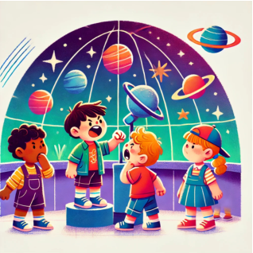

## 题目描述

时间限制：2 秒；内存限制：2048 MB。

带一群幼儿园的孩子去天文馆并不容易。你非常想这样做，让每个孩子都有机会进入装有巨型望远镜的房间看一眼木星。现在既然要去，你回想起其他看护人讲的故事：孩子们可能会调皮捣蛋，给后面的孩子留下一些令人讨厌的“惊喜”。你非常想避免这种情况。



Generated by ChatGPT 4o

你非常了解小组里的孩子。每个孩子都嫉妒另一个比他们更酷的孩子，如果他们知道自己嫉妒的孩子会在他们之后进入望远镜室（不一定是紧接着，只要是在之后某个时间点），他们就可能会调皮捣蛋。你原以为这很简单——班上最酷的孩子没有嫉妒的对象，所以她可以第一个进去，然后其他孩子按酷的程度依次进入。然而，你刚刚得知最酷的孩子是个例外——她不是嫉妒比自己更酷的人，而是嫉妒组里的某个随机孩子。这听起来简直是一场灾难！

幸运的是，你也知道每个孩子都有另一个他们非常、非常喜欢的孩子。因此，每当望远镜室里的孩子考虑制造惊喜时，如果他们知道自己喜欢的孩子会在他们之后、且在他们嫉妒的孩子之前进入房间，他们就不会调皮捣蛋。形式化地说，如果孩子 $A$ 嫉妒孩子 $B$，并且非常喜欢孩子 $C$，那么当 $B$ 在 $A$ 之后进入望远镜室，且 $C$ 在 $A$ 之前或在 $B$ 之后进入房间时，存在 $A$ 调皮捣蛋并制造惊喜的风险。

你能找出一个让孩子们进入望远镜室的顺序，使得没有任何惊喜发生吗？

## 输入格式

第一行包含一个整数 $n$ ($3 \le n \le 200\,000$)，表示小组中孩子的数量。孩子们按酷的程度从 $1$ 到 $n$ 编号（$1$ 最酷）。接下来的 $n$ 行，每行描述一个孩子。第 $i$ 行包含两个整数：$j_i$ 表示第 $i$ 个孩子嫉妒的孩子编号，$l_i$ 表示第 $i$ 个孩子非常喜欢的孩子编号（对于除 $1$ 以外的所有 $i$，$1 \le j_i, l_i \le n, j_i \neq l_i, j_i \neq i, l_i \neq i$ 且 $j_i < i$）。

## 输出格式

输出一行，包含 $n$ 个整数，表示孩子们进入望远镜室的顺序。如果存在多种排序方式，输出其中任意一种。如果不存在这样的顺序，输出 `impossible`。

## 样例

### 输入格式 1

```text
4
4 2
1 4
2 4
2 1
```

### 输出格式 1

```text
1 2 3 4
```

### 输入格式 2

```text
4
2 3
1 4
2 1
1 2
```

### 输出格式 2

```text
impossible
```
