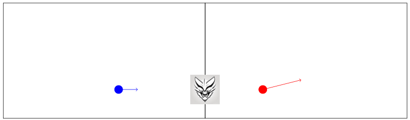

## 题目描述

时间限制：6 秒；内存限制：2048 MB。

无需热力学知识即可解决此问题。

麦克斯韦妖坐落在一个高为 $h$、宽为 $2w$ 的容器中。容器被分为两个相邻的隔间，每个隔间高为 $h$、宽为 $w$。一堵不可穿透的墙将两个隔间隔开，恶魔坐在该中心墙上的一个固定位置。

隔间内包含粒子，每个粒子都有位置、速度和颜色。当粒子撞击隔间的墙壁时，它会以完全弹性碰撞的方式反弹。图 H.1 展示了一个包含两个粒子的容器，左侧隔间有一个蓝色粒子，右侧隔间有一个红色粒子。



图 H.1：第一个样例输入。图中显示的恶魔被放大并以灰色表示，而实际上它小到可以忽略不计（且没有面部）。

麦克斯韦妖试图通过对粒子进行分类来降低熵。它希望所有红色粒子都在左侧隔间，所有蓝色粒子都在右侧隔间。为了实现这一点，它拥有一种特殊能力：当粒子撞击恶魔所在位置时，它可以允许粒子穿过中心墙。

隔间底部位于 $x$ 轴上，它们的中心分隔墙沿正 $y$ 轴延伸。在恶魔选择的任何时间，所有位于恶魔位置 $(0, d)$ 的粒子都不会从中心墙反弹，而是会穿过墙进入另一个隔间，并保持其速度不变。恶魔可以随时随地执行此操作，也可以选择即使粒子撞击了恶魔位置也不允许其通过。然而，如果多个粒子同时位于位置 $(0, d)$，则要么所有这些粒子都穿过中心墙，要么所有粒子都反弹。

帮助恶魔对粒子进行分类并降低熵！所有红色粒子位于左侧隔间且所有蓝色粒子位于右侧隔间所需的最早时间是多少？

## 输入格式

第一行包含五个整数 $w, h, d, r, b$，其中 $w$ 和 $h$ ($2 \le w, h \le 200$) 分别是每个隔间的宽度和高度，$d$ ($0 \le d \le h$) 是恶魔在容器中心墙上的 $y$ 坐标，$r$ 和 $b$ ($0 \le r, b$ 且 $1 \le r + b \le 200$) 分别是红色和蓝色粒子的数量。

接下来是 $r + b$ 行，每行描述一个粒子，包含四个整数 $p_x, p_y, v_x, v_y$，其中 $(p_x, p_y)$ ($0 < |p_x| < w, 0 < p_y < h$) 是粒子的初始位置，$(v_x, v_y)$ ($|v_x| < w, |v_y| < h, (v_x, v_y) \neq (0, 0)$) 是粒子的初始速度。描述的前 $r$ 个粒子为红色，其余为蓝色。

## 输出格式

输出所有红色粒子位于左侧隔间且所有蓝色粒子位于右侧隔间所需的最少时间。你的答案应具有不超过 $10^{-6}$ 的绝对或相对误差。如果无法在有限时间内使所有红色粒子位于左侧隔间且所有蓝色粒子位于右侧隔间，则输出 `impossible`。

## 样例

### 样例输入 1

```text
7 4 1 1 1
2 1 4 1
-3 1 2 0
```

### 样例输出 1

```text
24.0
```

### 样例输入 2

```text
4 4 1 2 2
3 1 2 2
-2 3 -2 -1
3 2 1 -2
-2 2 2 2
```

### 样例输出 2

```text
impossible
```
