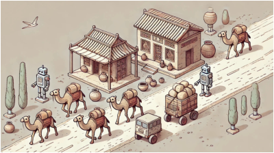

## 题目描述

时间限制：5 秒；内存限制：2048 MB。

古代丝绸之路的部分路段经过哈萨克斯坦南部。你一直在构想一条现代丝绸之路，它有着自己独特的特点。在这条幻想中的道路上，既有机器人，也有存放着坚戈（哈萨克斯坦的国家货币）的商店。如果一个机器人移动到一个有商店的位置，该机器人就会为你收集该商店所有的坚戈。



Generated by ChatGPT 4o

移动机器人的成本是每移动一米花费 1 坚戈。因此，将一个机器人移动到商店所获得的利润等于该商店持有的坚戈数量减去机器人到达该商店所移动的距离（米）。

考虑这个跨越数天的场景。最初，道路是空的，没有机器人或商店。每天，都会有一个新的机器人或一个新的商店被放置在道路上一个未被占用的位置。在此之前，道路上现有的每个商店都会被重新补给坚戈，使其总额与最初放置时相同，并且每个机器人都会被送回其初始起始位置。

对于每一天，你需要确定通过移动机器人收集商店中的坚戈所能获得的最大利润。注意，没有两个机器人起始于同一个位置，但它们在移动过程中可以占据相同的位置。每个商店在一天内只能被清空一次。

## 输入格式

第一行包含一个整数 $n$ ($1 \le n \le 2 \cdot 10^5$)，表示天数。接下来是 $n$ 行，其中第 $i$ 行以一个整数 $t_i$ 开头，如果第 $i$ 天添加的是一个新机器人，则 $t_i = 1$；如果添加的是一个新商店，则 $t_i = 2$。随后是一个整数 $x_i$ ($0 \le x_i \le 10^8$)，表示新机器人或新商店的位置。如果 $t_i = 2$，该行还会包含另一个整数 $c_i$ ($0 \le c_i \le 10^8$)，表示该商店拥有的坚戈数量。所有给定的位置都是不同的。

## 输出格式

输出 $n$ 个整数，表示每一天之后你能获得的最大利润。

## 样例

### 输入格式 1

```text
6
1 20
2 15 15
2 40 50
1 50
2 80 20
2 70 30
```

### 输出格式 1

```text
0
10
35
50
50
60
```
