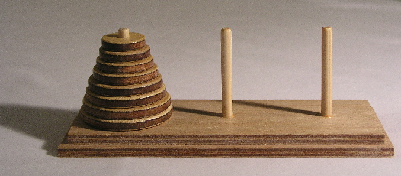

## 题目描述

时间限制：1 秒；内存限制：2048 MB。

Lucas 认为他六岁的儿子已经准备好学习一些基础算法了。为了入门，他选择了最美丽的技巧之一：递归，并为了演示它，他挑选了一个著名的递归游戏：汉诺塔。

汉诺塔是一个数学游戏，由三根杆子和若干个不同直径的圆盘组成，圆盘可以滑入任何一根杆子上。游戏开始时，所有圆盘按大小顺序堆叠在第一根杆子上，最小的在最上面，从而近似成一个圆锥形。游戏的目的是将整个圆盘堆叠移动到最后一根杆子上，并遵守以下规则：

-   一次只能移动一个圆盘。
-   每次移动包括从其中一个堆叠中取出最上面的圆盘，并将其放置在另一个堆叠的顶部或空杆上。
-   任何圆盘都不能放置在比它小的圆盘之上。

Lucas 知道，解决一个汉诺塔游戏所需的最少移动次数是 $2^n - 1$，其中 $n$ 是圆盘的数量。此外，最优移动序列是唯一的，这意味着在始终最优移动的前提下，$n$ 和已完成的移动次数唯一地代表了游戏的当前状态。

Lucas 正在一步步向他儿子展示如何玩这个游戏。他已经完成了前 $k$ 次最优移动。由于完成游戏还需要一段时间，他休息了一会儿去吃点零食。不幸的是，当他回来时，他发现他淘气的儿子做了一个“大动作”：知道目标是将所有圆盘从第一根杆子移动到最后一根杆子，他的儿子直接在一次移动中将“所有圆盘从第一根杆子移动到了最后一根杆子”（没有改变它们各自的顺序），见图 K.1。



图 K.1：儿子进行“大动作”前后的游戏布局。

Lucas 认为他仍然可以利用这个机会进行教学。他决定继续只使用“有效”移动来完成游戏。然而，他想知道完成游戏当前所需的最少移动次数是多少。由于他还要忙着管教儿子，他需要你的帮助！

注意，即使在给定的状态是非法的情况下，“有效”移动的定义仍然明确。也就是说，你一次只能移动一个最上面的圆盘，并且不能将其放置在比它小的圆盘之上。特别地，如果一根杆子最上面的圆盘大小为 $c$，将一个大小为 $a$ 的圆盘放在包含一个大小为 $b$ ($b < a$) 的圆盘的杆子上是有效的，只要满足 $a < c$。

## 输入格式

第一行包含一个整数 $n$ ($1 \le n \le 200\,000$)，表示游戏中的圆盘数量。 第二行包含一个整数 $k$ ($0 \le k \le 2^n - 1$)，表示 Lucas 在“大动作”之前完成的最优移动次数。注意 $k$ 以二进制形式给出。

## 输出格式

输出一个二进制整数，表示完成游戏所需的最少移动次数。

## 样例

### 样例输入 1

```text
3
0
```

### 样例输出 1

```text
0
```

### 样例输入 2

```text
3
10
```

### 样例输出 2

```text
110
```

### 样例输入 3

```text
5
11011
```

### 样例输出 3

```text
11
```
