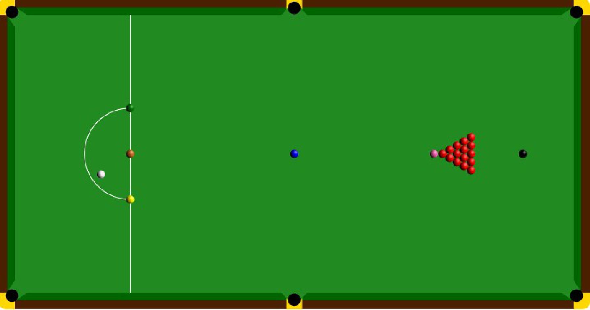

## 题目描述

时间限制：1.0 秒；内存限制：1024 MB。

台球是一项选手使用球杆击打白色母球并将其他球打入球袋的运动。其中一种著名的玩法是斯诺克（Snooker）。随着赵心童夺得斯诺克世界锦标赛冠军，这项运动在中国受到了更多关注。斯诺克的规则相当复杂，本题主要关注其计分规则。请注意，此处描述的斯诺克规则可能与实际规则有所不同，请以题面描述为准。

首先，让我们熟悉一下斯诺克中的 $21$ 颗球。红球：每颗值 $1$ 分，共 $15$ 颗。彩球：黄球（$2$ 分）、绿球（$3$ 分）、棕球（$4$ 分）、蓝球（$5$ 分）、粉球（$6$ 分）、黑球（$7$ 分），每种颜色各只有一颗球。



我们将一局斯诺克中的两名选手称为选手 A 和选手 B。两人的初始得分均为 $0$。由选手 A 先手开始，整个流程如下：

1.  如果球桌上还有红球，当前选手必须先击打一颗红球入袋。如果成功，其得分加一分并进入步骤 $2$；如果失败，则轮换到对手，对手从步骤 $1$ 开始。如果球桌上已经没有红球，则进入步骤 $3$。
2.  在将一颗红球击入袋后，当前选手应当任选六颗彩球中的一颗将其击入袋。如果成功，将该彩球对应的分值加到其得分中，然后**将被击入袋的彩球放回球桌**（这是唯一会将入袋球放回球桌的情况；在所有其他情况下，入袋的球均不再放回球桌），接着回到步骤 $1$；如果失败，则轮换到对手，对手从步骤 $1$ 开始。请注意，即使刚才打入的红球是球桌上的最后一颗红球，在打入红球后也必须执行这一步。
3.  如果球桌上已经没有红球，则进入清彩阶段。当前选手必须将球桌上剩余彩球中**分值最低**的那颗彩球击入袋。如果成功，将对应分值加到其得分中并继续执行步骤 $3$；如果失败，则轮换到对手，对手从步骤 $1$ 开始（但在实际执行时会直接跳到步骤 $3$）。如果球桌上已无剩余球，则本局结束。

为方便起见，本题不考虑任何犯规或特殊情况，包括但不限于同时打入多颗球或打入非目标球。只需考虑上述提到的情形。

由于加班，Panda 错过了一局斯诺克的开头。当他回到家打开电视时，看到当前有一名选手正在球桌旁击球。此时球桌上共有 $n$ 颗球（包括红球和彩球），其中任何应当放回球桌的球都已经放回，且选手 A 和选手 B 当前的比分为 $a : b$。Panda 想要根据当前局面推演此前可能发生的过程。具体而言，请输出任意一个从开局到达给定当前状态的成功与失败击球序列（按下述输出格式编码），或者判定不存在这样的序列。如果存在多种合法方案，输出任意一种即可。

## 输入格式

第一行包含一个整数 $T$（$1 \le T \le 2000$），表示测试数据的组数。

接下来的 $T$ 行，每行包含四个整数 $a, b, n, p$（$0 \le a, b \le 200$，$0 \le n \le 21$，$0 \le p \le 1$），表示选手 A 和选手 B 当前的比分为 $a : b$，且球桌上当前剩余的红球与彩球总数为 $n$。如果 $p = 0$，表示当前由选手 A 在球桌旁击球；如果 $p = 1$，表示当前由选手 B 在球桌旁击球。

## 输出格式

对于每组测试数据，输出一个表示步骤序列的字符串，其中数字字符 `1` 到 `7` 表示当前选手打入了对应分值的球，字符 `/` 表示当前选手未能将球打入袋，从而轮换给对手。如果不存在合法的序列，则在单行中输出 `NA`。如果存在多种解，输出任意一种即可。每组测试数据输出字符串的长度不应超过 $100$。请勿输出多余的空格。

## 样例

### 样例输入 1

```text
7
8 110 1 1
147 0 0 0
0 0 21 0
1 0 20 0
1 1 19 1
0 0 0 0
147 0 0 1
```

### 样例输出 1

```text
/16121516/17/1717171717171217121423456
171717171717171717171717171717234567

//1//
/1/1/
NA
NA
```

## 说明

样例中的第一组测试数据是赵心童夺得斯诺克世界锦标赛冠军的决胜局（选手 A 为马克·威廉姆斯，选手 B 为赵心童）。

---

来源：[QOJ 中文题面](https://qoj.ac/problem/14709/statement/zh_cn)。保留 QOJ 提供的中文内容，仅转换为 Markdown 排版；原题及图示版权归原作者所有。
