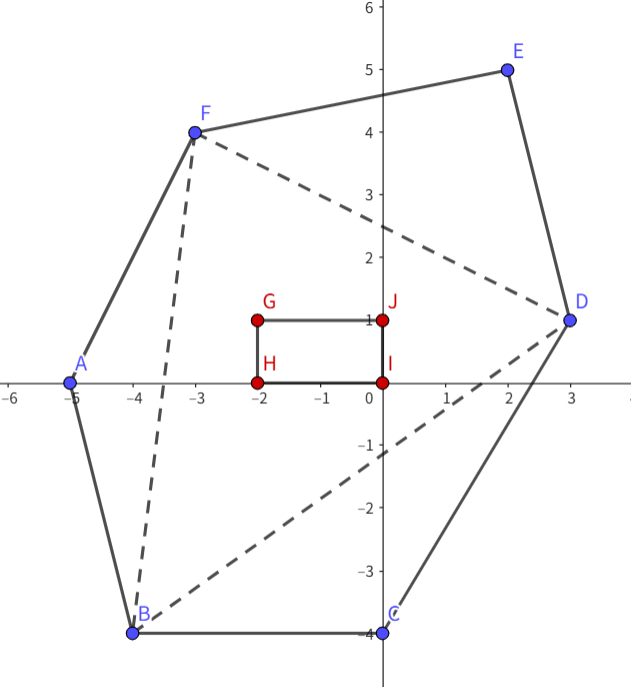

## 题目描述

时间限制：2.0 秒；内存限制：1024 MB。

如果多边形 $P_2$ 内部或边界上的每个点都在多边形 $P_1$ 内部或边界上，则称多边形 $P_1$ 包含多边形 $P_2$。如果多边形 $P_2$ 内部或边界上的每个点都严格在多边形 $P_1$ 的内部（边界上没有点），则称多边形 $P_1$ 严格包含 $P_2$。

熊猫有两个凸多边形 $P$ 和 $Q$。多边形 $P$ 有 $n$ 个顶点，多边形 $Q$ 有 $m$ 个顶点。保证 $Q$ 被 $P$ 严格包含。

你需要帮助熊猫求出，从多边形 $P$ 中恰好选择 3 个不同的顶点组成三角形 $P_\Delta$，使得 $P_\Delta$（非严格）包含多边形 $Q$ 的总方案数。



## 输入格式

第一行包含一个整数 $T$ ($1 \le T \le 1000$)，表示测试用例的数量。

对于每个测试用例：

第一行包含一个整数 $n$ ($3 \le n \le 3 \cdot 10^5$)，表示 $P$ 的顶点数。

接下来的 $n$ 行，每行包含两个整数 $x, y$ ($|x|, |y| \le 10^9$)，表示 $P$ 的顶点的坐标。保证顶点按逆时针顺序给出，且任意三个顶点不共线。

下一行包含一个整数 $m$ ($3 \le m \le 3 \cdot 10^5$)，表示 $Q$ 的顶点数。

接下来的 $m$ 行，每行包含两个整数 $x, y$ ($|x|, |y| \le 10^9$)，表示 $Q$ 的顶点的坐标。保证顶点按逆时针顺序给出，且任意三个顶点不共线，并且 $Q$ 被 $P$ 严格包含。

保证所有测试用例的 $\sum n$ 和 $\sum m$ 均不超过 $5 \cdot 10^5$。

## 输出格式

对于每个测试用例，单行输出一个整数，表示答案。

## 样例

### 输入格式 1

```text
3
6
-5 0
-4 -4
0 -4
3 1
2 5
-3 4
4
-2 1
-2 0
0 0
0 1
6
-5 0
-4 -4
0 -4
3 1
2 5
-3 4
4
-1 1
-1 0
0 0
0 1
7
1 -3
4 -1
5 0
1 4
0 4
-1 0
0 -2
3
0 0
2 0
0 2
```

### 输出格式 1

```text
2
4
6
```

### 说明

对于第一个样例，如图所示，多边形 $P$ 为 $ABCDEF$，多边形 $Q$ 为 $GHIJ$。包含 $Q$ 的三角形为 $\Delta ACE$ 和 $\Delta BDF$。
