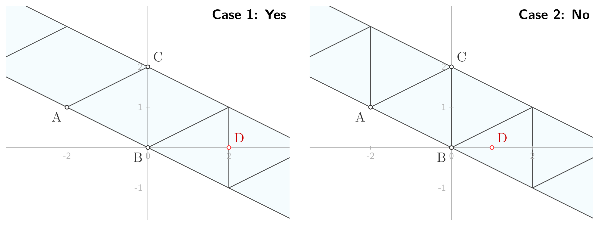

> QOJ 将此版本标注为 AI 翻译，可能存在不准确之处；有疑问时请核对原文。

## 题目描述

时间限制：2.0 秒；内存限制：2048 MB。

杰出的亿万富翁蔡先生有一个非常特别的强迫症：只有当他的双脚牢牢地踩在瓷砖的边或顶点上（即某块地板砖的边界上）时，他才会感到舒适。最近，他购入了一批相同的、高档的三角形地板砖。他计划用这些瓷砖在他新豪宅的一条长而直的走廊上铺设地板。

走廊是二维平面上的一个无限带状区域。为了确保设计符合他的最高标准，蔡先生制定了严格的铺设规则：每块三角形瓷砖的放置必须跨越走廊的整个宽度，并同时接触两条平行的边界线。这将在带状区域上形成一个连续的、单排的镶嵌图案。其中一块瓷砖必须与他最喜欢的参考三角形完全一致，而所有其他瓷砖必须与该参考三角形全等。

蔡先生目前正站在走廊里的一个固定位置。在经历了一整天漫长的改造工作后，他已经精疲力竭，坦白地说，他根本不想动。他希望瓷砖能从他的参考三角形开始，自动在地面上向外延伸铺设，只要最终的图案符合他的规则即可。当然，只有当瓷砖的某条边或某个顶点与他当前的位置重合时，才算成功！

你的任务是确定是否可能铺设走廊，使得蔡先生当前的位置（点 $D$）恰好落在包含 $\triangle ABC$ 的镶嵌图案的边或顶点上。走廊的边界被定义为两条唯一的平行线 $l_1$ 和 $l_2$，其中 $l_1$ 穿过 $A$ 和 $B$，$l_2$ 穿过 $C$。由 $(l_1, l_2)$ 形成的带状区域的镶嵌是指使用 $\triangle ABC$ 的全等副本（允许平移、旋转和反射）对整个带状区域进行无重叠、无缝隙的铺设。



前两个样例测试用例的示意图。

## 输入格式

输入包含多组测试数据。输入的第一行包含一个整数 $T$ ($1 \le T \le 10^3$)，表示测试数据的组数。对于每组测试数据：

第一行包含两个整数 $x_a$ 和 $y_a$ ($-100 \le x_a, y_a \le 100$)，表示点 $A$ 的坐标。

第二行包含两个整数 $x_b$ 和 $y_b$ ($-100 \le x_b, y_b \le 100$)，表示点 $B$ 的坐标。

第三行包含两个整数 $x_c$ 和 $y_c$ ($-100 \le x_c, y_c \le 100$)，表示点 $C$ 的坐标。

第四行包含两个分数 $x_{d1}/x_{d2}$ 和 $y_{d1}/y_{d2}$，其中 $x_{d1}, x_{d2}, y_{d1}, y_{d2}$ 是满足 $-10^7 < x_{d1}, y_{d1} < 10^7$ 且 $0 < x_{d2}, y_{d2} < 10^7$ 的整数，表示点 $D$ 的坐标。

保证 $A$、$B$ 和 $C$ 构成一个非退化的三角形。

## 输出格式

对于每组测试数据，如果存在一种合法的铺设方案，使得点 $D$ 恰好落在图案中至少一个三角形的边或顶点上，则在一行中输出 "Yes"。否则，输出 "No"。

## 样例

### 输入 1

```text
4
-2 1
0 0
0 2
2/1 0/1
-2 1
0 0
0 2
1/1 0/1
0 1
-2 1
0 2
1/2 7/4
0 1
-2 1
0 2
-3/2 3/4
```

### 输出 1

```text
Yes
No
Yes
No
```
