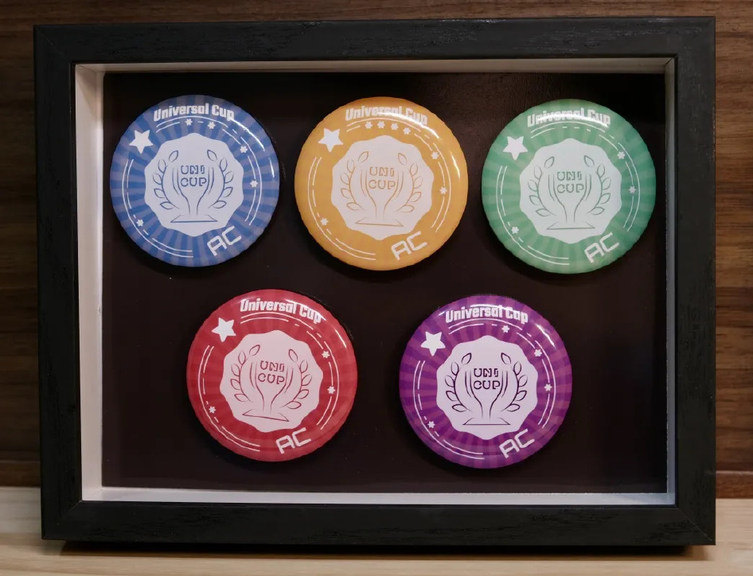

> QOJ 将此版本标注为 AI 翻译，可能存在不准确之处；有疑问时请核对原文。

## 题目描述

时间限制：2.0 秒；内存限制：2048 MB。

现在是 2075 年。在整理档案时，你重新发现了 2025 年 ICPC 区域赛的一套徽章，这些徽章最初是由 Universal Cup 组织分发的。



一套完整的 UCup 徽章。

然而，在本题中，我们只考虑其中三种颜色的子集。

你的徽章只有三种不同的颜色：群青色（Ultramarine，用 `u` 表示）、绯红色（Crimson，用 `c` 表示）和长春花蓝色（Periwinkle，用 `p` 表示）。一个完整的纪念包定义为按以下精确顺序排列的四个徽章：群青色、绯红色、群青色、长春花蓝色（即 `ucup`）。

你的收藏由排成一排的 $4n$ 个徽章组成。你清晰地记得在 2025 年，这个排列是一个**完美批次**：

-   该序列可以被划分为 $n$ 个互不相交的子序列（即每个徽章恰好属于一个子序列），使得每个子序列都构成一个完整的纪念包（`ucup`）。

然而，在过去的 50 年里，一些徽章已经褪色，导致它们的颜色无法辨认。这些位置用 `?` 表示。

给定徽章序列的当前状态 $S$，计算将褪色位置（`?`）还原为 `u`、`c` 或 `p` 之一，使得最终得到的序列是一个完美批次的方案数。由于答案可能很大，请将其对 $998\,244\,353$ 取模后输出。

注意，子序列可以通过在不改变剩余字符顺序的情况下，从字符串中删除零个或多个字符来获得。例如，`ucp`、`c` 和 `ucup` 都是字符串 `ucup` 的子序列，而 `uucp` 不是字符串 `ucup` 的子序列。

## 输入格式

第一行包含一个整数 $n$（$1 \le n \le 50$）。

第二行包含一个长度为 $4n$ 的字符串 $S$，由字符 `u`、`c`、`p` 和 `?` 组成。

## 输出格式

输出将 $S$ 中的每个 `?` 替换为 `u`、`c` 或 `p` 之一，使得得到的字符串表示一个完美批次的方案数，结果对 $998\,244\,353$ 取模。

## 样例

### 输入样例 1

```text
1
????
```

### 输出样例 1

```text
1
```

### 输入样例 2

```text
1
ucup
```

### 输出样例 2

```text
1
```

### 输入样例 3

```text
1
uucp
```

### 输出样例 3

```text
0
```

### 输入样例 4

```text
1
uu?u
```

### 输出样例 4

```text
0
```

### 输入样例 5

```text
2
????????
```

### 输出样例 5

```text
11
```

### 输入样例 6

```text
4
u???c???u???p???
```

### 输出样例 6

```text
437
```
