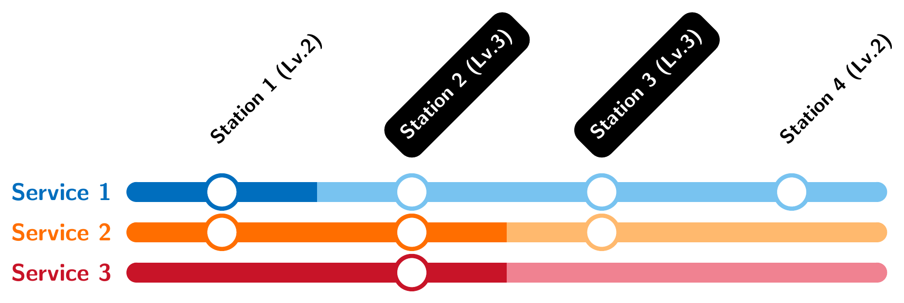

## 题目描述

时间限制：3.0 秒；内存限制：2048 MB。

他的梦想，伴随着 C 市的特快列车，呼啸着驶过他正在等待的车站，只留下他孤单一人。

C 市开通了一条拥有 $n$ 个车站的新地铁线路。第 $i$ 个车站的等级为 $1 \le a_i \le k$，代表该车站的重要性。通常情况下，车站的等级越高，停靠的列车就越多。

C 市计划在这条新地铁线路上开通 $m$ 种列车服务。第 $i$ 种服务有一个分界点 $p_i$，以及两个等级参数 $x_i$ 和 $y_i$，表示该服务的列车将在从第 $1$ 个车站到第 $p_i$ 个车站中，停靠所有等级至少为 $x_i$ 的车站；并在从第 $(p_i + 1)$ 个车站到第 $n$ 个车站中，停靠所有等级至少为 $y_i$ 的车站。更正式地，它们会停靠所有满足以下至少一个条件的车站 $j$：

-   $j \le p_i$ 且 $a_j \ge x_i$；
-   $j > p_i$ 且 $a_j \ge y_i$。

让我们来看一些例子：

-   如果 $x_i = y_i = 1$，列车将在每个车站停靠。这种列车服务也被称为 _普通服务_（Local Service）。
-   如果 $x_i = y_i = k$，列车将只在等级为 $k$ 的车站停靠。这种列车服务也被称为 _限时特快_（Limited Express）或 _标杆车_（Benchmark Train）。
-   如果 $x_i = 1, y_i = k$，该服务在 $1$ 到 $p_i$ 之间是 _普通服务_，在 $(p_i + 1)$ 到 $n$ 之间是 _限时特快_。这可以是 _贯通服务_（Through Service），在市中心每站都停，在郊区则提速运行。

如果至少有一种列车服务在两个不同的车站都停靠，则称这两个车站是**直接可达**的。如果所有等级相同（$a_i = a_j$）的互不相同的车站对 $(i, j)$ 都是直接可达的，我们就称这条地铁线路是**高效的**。

给你 $p_1, \dots, p_m$ 和 $x_1, \dots, x_m$。请计算有多少种可能的 $y_1, \dots, y_m$ 方案（由 $1$ 到 $k$ 之间的正整数组成），使得该地铁线路是高效的。由于答案可能很大，请输出答案模 $998\,244\,353$ 的结果。

## 输入格式

第一行包含三个整数 $n$ ($2 \le n \le 10^3$)、$m$ ($1 \le m \le 10^3$) 和 $k$ ($1 \le k \le 500$)，分别表示车站数量、列车服务数量以及车站等级的上限。不保证每个等级都至少有一个车站。

第二行包含 $n$ 个整数 $a_1, a_2, \dots, a_n$ ($1 \le a_i \le k$)，表示每个车站的等级。

接下来的 $m$ 行描述列车服务。其中的第 $i$ 行包含两个整数 $p_i$ ($1 \le p_i < n$) 和 $x_i$ ($1 \le x_i \le k$)，表示第 $i$ 种列车服务的两个参数。

## 输出格式

输出一个整数，表示可能的数组 $y_1, \dots, y_m$ 的数量，模 $998\,244\,353$。

## 样例

### 输入格式 1

```text
4 3 4
2 3 3 2
1 2
2 2
2 3
```

### 输出格式 1

```text
48
```

### 说明

样例 1 解释：下图展示了一种可能的配置 $y = [2, 3, 4]$：



样例 1 解释图

-   服务 1：$p_1 = 1, x_1 = 2, y_1 = 2$；
-   服务 2：$p_2 = 2, x_2 = 2, y_2 = 3$；
-   服务 3：$p_3 = 2, x_3 = 3, y_3 = 4$。

### 输入格式 2

```text
7 3 5
2 4 3 2 4 2 3
2 2
4 3
5 2
```

### 输出格式 2

```text
80
```

### 输入格式 3

```text
4 2 10
3 7 2 5
1 4
3 3
```

### 输出格式 3

```text
100
```
